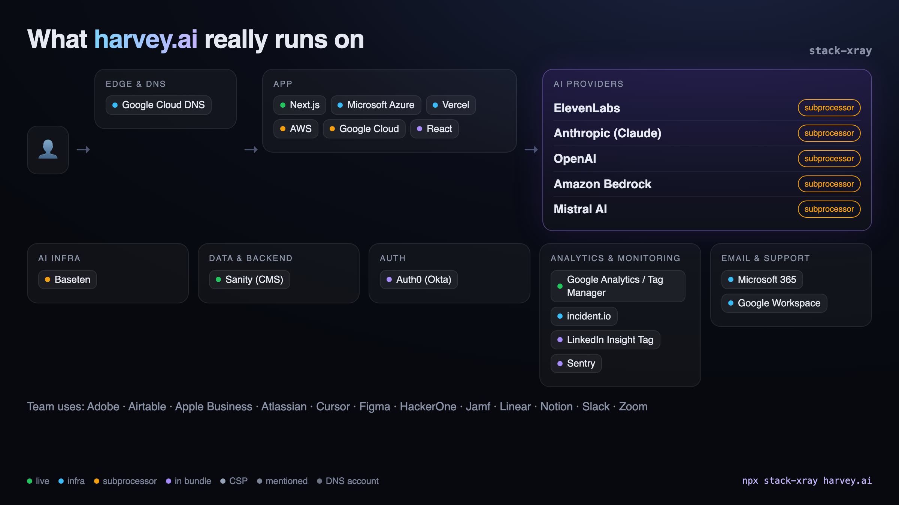

<div align="center">

# stack-xray

### See what any startup's product really runs on, including which AI providers it actually uses.

<code>npx stack-xray harvey.ai</code>



</div>

---

Point `stack-xray` at a domain and get a diagram of how the product is built
(edge, hosting, framework, backend, auth, payments, analytics) and **which LLM
providers and models sit behind it**. Every claim comes with the evidence that
produced it and a tier that says how strong that evidence is.

It runs from the outside, against public pages only. No login, no API probing.

```text
$ npx stack-xray harvey.ai

  AI providers
    ● ElevenLabs                    94%  named on subprocessor, trust or status page
    ● Anthropic (Claude)            90%  named on subprocessor, trust or status page
    ● OpenAI                        90%  named on subprocessor, trust or status page
    ● Amazon Bedrock                85%  named on subprocessor, trust or status page
    ● Mistral AI                    85%  named on subprocessor, trust or status page
  Edge & DNS               Google Cloud DNS(infra)
  App                      Next.js(live), Microsoft Azure(infra), Vercel(infra), ...
  Analytics & monitoring   Google Analytics / Tag Manager(live), incident.io(infra), Sentry(in bundle), ...
  Team tools               Adobe, Airtable, Atlassian, Cursor, Figma, Linear, Notion, Slack, Zoom

  → stack-xray-out/harvey.ai/report.md · card.html · diagram.mmd · stack.json
```

## Why the evidence tiers matter

"Company X uses OpenAI" can mean very different things. stack-xray keeps them apart:

| Tier | What it means | Weight |
| --- | --- | --- |
| **live** (`observed`) | The browser loaded or called the host: a script tag, or traffic captured through [REA](https://github.com/morluto/rea) | 0.95 |
| **infra** | DNS records or HTTP response headers | 0.90 |
| **subprocessor** (`declared`) | Named on the company's subprocessor list, trust center or status page | 0.85 |
| **in bundle** | Shipped JavaScript references the vendor, SDK or a model id like `claude-sonnet-4-5` | 0.70 |
| **CSP** (`config`) | Allowed in the Content-Security-Policy, not yet seen in use | 0.60 |
| **mentioned** | Mentioned on a generic privacy or security page | 0.45 |
| **DNS account** | A domain-verification TXT record only, e.g. `anthropic-domain-verification-…` | 0.35 |

That last one is worth a note: most AI startups have **both** `openai-domain-verification`
and `anthropic-domain-verification` records. That usually means the team uses ChatGPT
Enterprise and Claude for Work, not that the product calls either API. stack-xray shows
these as dashed, low-confidence edges instead of pretending they're proof.

Independent tiers combine as `1 − Π(1 − w)`, so a vendor that's both on the
subprocessor list and referenced in the bundle ends up above either alone.

## What it looks at

| Collector | Signals |
| --- | --- |
| DNS | TXT (domain verifications, SPF), MX, NS, CNAME chains for `www`, `app`, `api`, `chat`, `docs`, `status`, `help`, `trust` |
| HTTP | Response headers, cookie names, Content-Security-Policy hosts |
| HTML | Framework markers, script/link/iframe hosts, inline scripts |
| JavaScript | Up to 40 first-party bundles: SDK markers, API hosts, model ids |
| Legal | Subprocessor lists, privacy and security pages, Vanta/SafeBase-style trust centers (rendered with headless Chrome when they're JS-only) |
| Status | Statuspage components, which often list upstream AI vendors |
| REA (`--rea`) | Live network observation through [REA](https://github.com/morluto/rea)'s passive CDP capture |

## Usage

```bash
npx stack-xray <domain> [more domains...] [options]

  --out <dir>          Output directory (default: ./stack-xray-out)
  --png                Render a 1200×675 card.png (X/Twitter-ready) with headless Chrome
  --rea                Add live network evidence via REA (Chrome required)
  --url <url>          Extra page to scan, repeatable (e.g. https://app.example.com/login)
  --signatures <dir>   Load extra signature files, repeatable
  --json               Print the JSON report to stdout
  --no-legal           Skip subprocessor / privacy / trust page discovery
```

Each domain gets:

- `report.md`: Mermaid diagram, AI provider table, per-finding evidence, limitations
- `stack.json`: everything, machine-readable
- `diagram.mmd`: the diagram on its own (renders on GitHub, Notion, Obsidian)
- `card.html` / `card.png`: the shareable card

### As a library

```ts
import { xray, toMermaid } from "stack-xray";

const report = await xray("lovable.dev");
report.findings.filter((f) => f.category === "ai-provider");
console.log(toMermaid(report));
```

## Use it from your agent

stack-xray ships an agent skill (`skills/stack-xray/SKILL.md`) that teaches Claude Code,
Cursor, Codex and friends how to run it, how to phrase each evidence tier, and when to
escalate to REA for runtime proof.

```bash
npx skills add jatingargiitk/stack-xray
```

Then ask: *"What is perplexity.ai built on, and which LLMs does it use? Show the evidence."*

## Deep mode with REA

[REA](https://github.com/morluto/rea) is a reverse-engineering MCP server and CLI with a
passive Chrome DevTools Protocol observer. With `--rea`, stack-xray:

1. starts a throwaway headless Chrome on the target,
2. hands REA every candidate third-party origin the passive scan found (CSP hosts, resource
   hosts, known AI API hosts), since REA only retains explicitly allowed origins,
3. scrolls the page during REA's capture window to trigger lazy chunks and beacons,
4. upgrades every host REA actually saw to **live**, and records REA's Evidence IDs in the report.

```bash
npx stack-xray cursor.com --rea
```

## Contributing signatures

The signature database is the product. It's plain JSON in [`signatures/`](signatures/), one
entry per vendor, and adding one is the easiest way to contribute:

```json
{
  "id": "groq",
  "name": "Groq",
  "category": "ai-provider",
  "website": "https://groq.com",
  "match": {
    "hosts": ["api\\.groq\\.com"],
    "text": ["\\bGroq\\b"]
  }
}
```

| Key | Matched against | Notes |
| --- | --- | --- |
| `dnsTxt`, `cname`, `ns`, `mx` | DNS records | case-insensitive |
| `headers` | `"header-name: value"` | header name lowercased |
| `cookies` | cookie names | |
| `html` | page HTML | |
| `hosts` | hostnames seen in resources, CSP, REA traffic, and bundle text | |
| `js` | JavaScript bundle text | **case-sensitive** |
| `text` | subprocessor / privacy / trust / status page text | **case-sensitive**, so `Cohere` doesn't match "cohere" |
| `models` | regex with one capture group, extracts model ids from bundles | |

Run `npm run validate && npm test` before opening a PR. See [CONTRIBUTING.md](CONTRIBUTING.md).

Wanted right now: more AI inference hosts, voice/agent platforms, vector databases,
LLM observability tools, and status-page component names.

## Limitations

- **Server-side calls are invisible from outside.** If a backend calls an LLM and the
  company doesn't list it anywhere public, stack-xray can't see it. Absence of evidence
  isn't evidence of absence.
- **Bot protection** (Cloudflare challenges etc.) can block the static fetch. The report
  lists collector errors; try `--rea` or `--url` with another page.
- **Model ids in bundles** can come from model pickers or marketing copy, and may be
  served through a different provider (e.g. Claude via Bedrock).

## Responsible use

stack-xray reads what any visitor's browser can already see: public DNS records, public
pages, and the JavaScript those pages ship. It doesn't log in, bypass protections, fuzz
endpoints, or send traffic beyond a normal page visit. Please keep it that way.

## License

[MIT](LICENSE)
