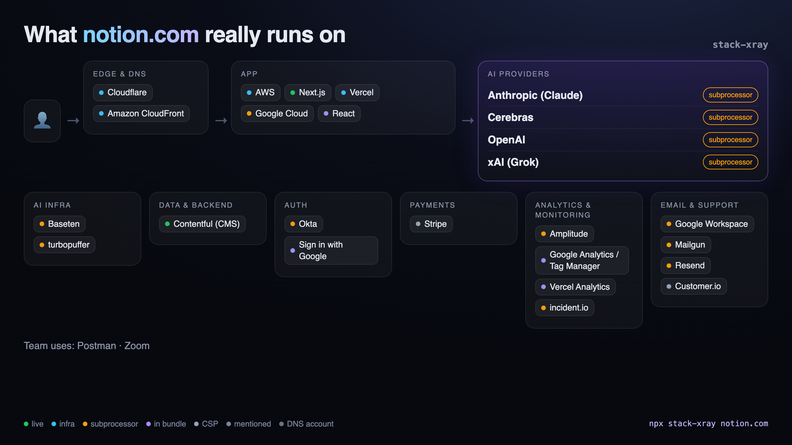
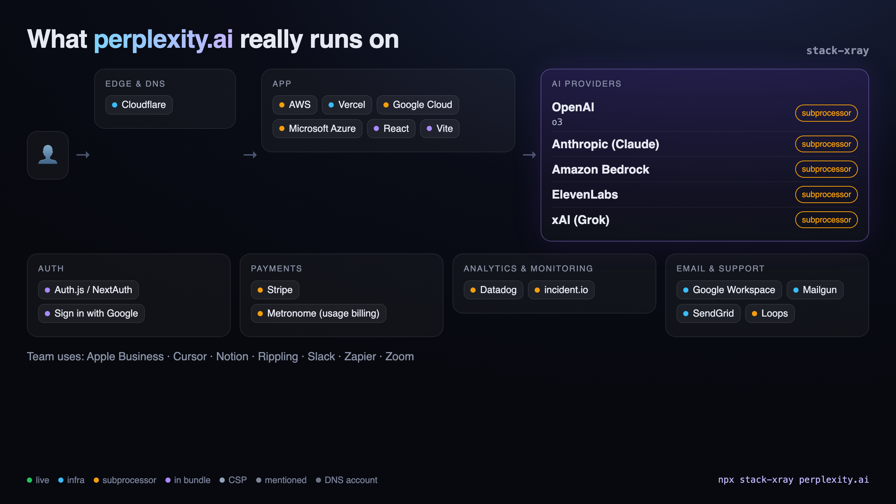
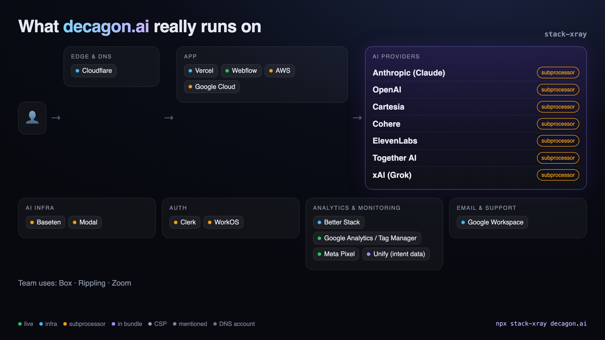
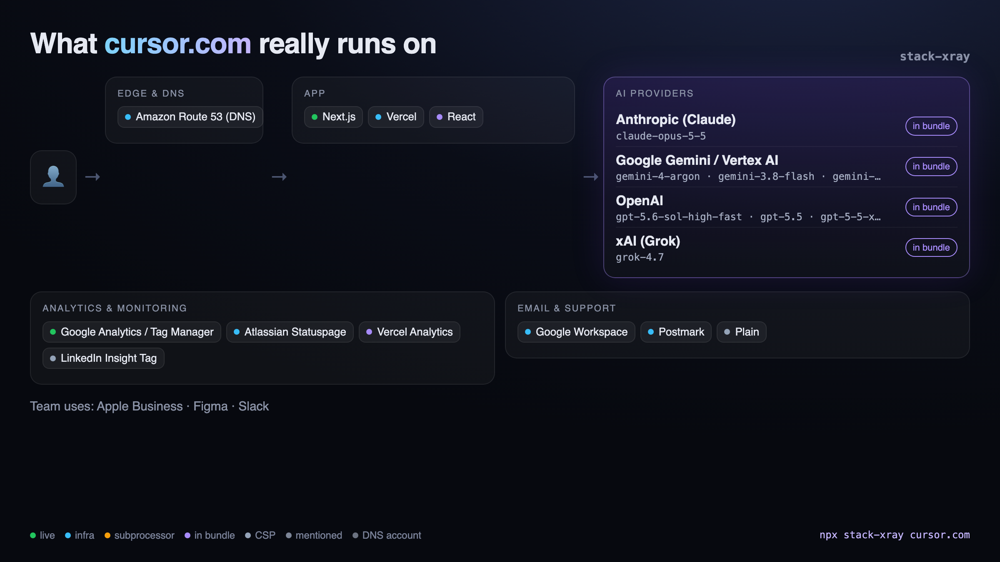

# Examples

Generated with `npx stack-xray <domain> --png` on 2026-10-15. Each `.md` is the full
report with evidence for every finding; the `.png` is the shareable card.

| Company | AI providers found | Strongest evidence |
| --- | --- | --- |
| [Notion](notion.com.md) | Anthropic, OpenAI, Cerebras, xAI | subprocessor list |
| [Perplexity](perplexity.ai.md) | OpenAI, Anthropic, Amazon Bedrock, xAI, ElevenLabs | trust center subprocessors |
| [Decagon](decagon.ai.md) | Anthropic, OpenAI, Cohere, Together AI, xAI, Cartesia, ElevenLabs | trust center subprocessors |
| [Harvey](harvey.ai.md) | OpenAI, Anthropic, Mistral, Amazon Bedrock, ElevenLabs | subprocessor list + app CSP |
| [Glean](glean.com.md) | OpenAI, Anthropic, Groq, Deepgram | subprocessor list |
| [Granola](granola.ai.md) | OpenAI, Anthropic, AssemblyAI, Deepgram, Fireworks, xAI | trust center subprocessors |
| [Lovable](lovable.dev.md) | Anthropic, OpenAI, Gemini, Azure OpenAI, OpenRouter, ElevenLabs | trust center subprocessors |
| [Cursor](cursor.com.md) | Anthropic, OpenAI, Gemini, xAI | model ids in shipped JavaScript |

Vendor lists change. Re-run the command to get today's answer.

