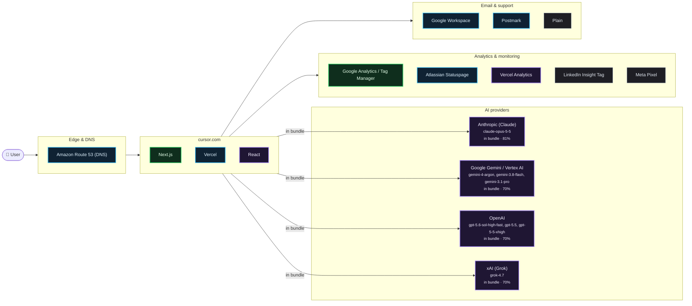

# What cursor.com runs on

Scanned https://cursor.com/ at 2026-10-15T04:53:05.132Z · 408 signals · 6.1 MB of JavaScript inspected

## AI providers

| Provider | Strongest evidence | Confidence | Models seen |
| --- | --- | --- | --- |
| Anthropic (Claude) | referenced in shipped JavaScript | 81% | claude-opus-5-5 |
| Google Gemini / Vertex AI | referenced in shipped JavaScript | 70% | gemini-3.1-pro, gemini-3.8-flash, gemini-4-argon |
| OpenAI | referenced in shipped JavaScript | 70% | gpt-5-4-high, gpt-5-4-xhigh, gpt-5-5-high, gpt-5-5-medium, gpt-5-5-xhigh, gpt-5.5 |
| xAI (Grok) | referenced in shipped JavaScript | 70% | grok-4.7 |

## Edge & DNS

- **Amazon Route 53 (DNS)** — infra, 90%

## App

- **Next.js** — live, 99%
- **Vercel** — infra, 90%
- **React** — in bundle, 70%

## Analytics & monitoring

- **Google Analytics / Tag Manager** — live, 99%
- **Atlassian Statuspage** — infra, 94%
- **Vercel Analytics** — in bundle, 88%
- **LinkedIn Insight Tag** — CSP, 60%
- **Meta Pixel** — CSP, 60%

## Email & support

- **Google Workspace** — infra, 90%
- **Postmark** — infra, 90%
- **Plain** — CSP, 60%

## Team tools (from DNS verification records)

Apple Business · Figma · Slack

## Evidence

<b>Google Analytics / Tag Manager</b> · analytics · 99%

- `observed` html @ https://cursor.com/: `…\nwindow.gtag = gtag;\\ngtag('js', new Date());\\ngtag('config', 'G-5H6JBHFD7Z', { send_page_view: false, server_…`
- `observed` html @ https://cursor.com/: `…src="https://www.googletagmanager.com/ns.html?id=GTM-M2R7938W" height="0" width="0" style="display:none;visibil…`
- `observed` resource @ https://www.googletagmanager.com/ns.html?id=GTM-M2R7938W: `www.googletagmanager.com`
- `bundle` bundle @ javascript bundles: `…]}]\n2d:[\"$\",\"iframe\",null,{\"src\":\"https://www.googletagmanager.com/ns.html?id=GT"]) ; self.__next_f.push([1,"M-M2R79…`
- `config` csp @ https://cursor.com/: `www.googletagmanager.com`

<b>Next.js</b> · framework · 99%

- `observed` html @ https://cursor.com/: `…w"/><link rel="stylesheet" href="/marketing-static/_next/static/chunks/0.fbkpi0lgef2.css?dpl=dpl_DWoCVMrStgDoSn3hM…`
- `observed` html @ https://cursor.com/: `…T_SIDE_RENDERING")</script></body></html><script>self…`
- `infra` header @ https://cursor.com/: `x-nextjs-prerender: 1`
- `infra` header @ https://cursor.com/: `x-nextjs-stale-time: 300`
- `infra` header @ https://cursor.com/: `x-matched-path: /en-US/home/desktop-eyJhbGciOiJIUzI1NiJ9.AAAAAAEB.-TgRIoU4kCr2wB-4KfrutR6TX-dZd18Hly-fNsFgQR4`

<b>OneTrust</b> · compliance · 99%

- `observed` resource @ https://cdn.cookielaw.org/scripttemplates/otSDKStub.js: `cdn.cookielaw.org`
- `bundle` bundle @ javascript bundles: `…(self.__next_s=self.__next_s||[]).push(["https://cdn.cookielaw.org/scripttemplates/otSDKStub.js",{"charSet":"UTF-8",…`
- `config` csp @ https://cursor.com/: `cdn.cookielaw.org`

<b>Atlassian Statuspage</b> · monitoring · 94%

- `infra` dns-cname @ status.cursor.com: `0tp9ssgtptvs.stspg-customer.com`
- `account` dns-txt @ cursor.com: `status-page-domain-verification=35154jm3n03g`

<b>Amazon Route 53 (DNS)</b> · edge · 90%

- `infra` dns-ns @ cursor.com: `ns-1366.awsdns-42.org`
- `infra` dns-ns @ cursor.com: `ns-1758.awsdns-27.co.uk`
- `infra` dns-ns @ cursor.com: `ns-265.awsdns-33.com`
- `infra` dns-ns @ cursor.com: `ns-682.awsdns-21.net`

<b>Google Workspace</b> · email · 90%

- `infra` dns-txt @ cursor.com: `v=spf1 include:_spf.google.com include:stspg-customer.com include:spf.mtasv.net ~all`
- `infra` dns-mx @ cursor.com: `alt4.aspmx.l.google.com`
- `infra` dns-mx @ cursor.com: `alt1.aspmx.l.google.com`
- `infra` dns-mx @ cursor.com: `alt2.aspmx.l.google.com`
- `infra` dns-mx @ cursor.com: `aspmx.l.google.com`
- `infra` dns-mx @ cursor.com: `alt3.aspmx.l.google.com`

<b>Postmark</b> · email · 90%

- `infra` dns-txt @ cursor.com: `v=spf1 include:_spf.google.com include:stspg-customer.com include:spf.mtasv.net ~all`

<b>Vanta</b> · compliance · 90%

- `infra` dns-cname @ trust.cursor.com: `641a10eda330118d4f90987f.cname.vantatrust.com`

<b>Vercel</b> · hosting · 90%

- `infra` dns-cname @ www.cursor.com: `cname.vercel-dns.com`
- `infra` header @ https://cursor.com/: `x-vercel-id: bom1::rqhj4-1792039985503-66f8757a0321`
- `infra` header @ https://cursor.com/: `server: Vercel`
- `infra` header @ https://cursor.com/: `x-vercel-cache: HIT`

<b>Vercel Analytics</b> · analytics · 88%

- `bundle` bundle @ javascript bundles: `…Send));let r=e.scriptSrc?e.scriptSrc:a()?"https://va.vercel-scripts.com/v1/script.debug.js":e.basePath?'${e.basePath}/ins…`
- `config` csp @ https://cursor.com/: `va.vercel-scripts.com`

<b>Anthropic (Claude)</b> · ai-provider · 81%

> An anthropic-domain-verification TXT record proves a Claude/Anthropic Console account, not that the product calls the API.

- `bundle` bundle @ javascript bundles: `claude-opus-5-5`
- `account` dns-txt @ cursor.com: `anthropic-domain-verification-1er2cj=fcUJsdJ7kfq2Lp6XgYABnKuOo`

<b>Google Gemini / Vertex AI</b> · ai-provider · 70%

- `bundle` bundle @ javascript bundles: `gemini-3.1-pro, gemini-3.8-flash, gemini-4-argon`

<b>OpenAI</b> · ai-provider · 70%

> An openai-domain-verification TXT record proves an OpenAI account (often ChatGPT Enterprise), not that the product calls the API.

- `bundle` bundle @ javascript bundles: `gpt-5-4-high, gpt-5-4-xhigh, gpt-5-5-high, gpt-5-5-medium, gpt-5-5-xhigh, gpt-5.5`

<b>React</b> · framework · 70%

- `bundle` bundle @ javascript bundles: `…n}}var eq=Math.random().toString(36).slice(2),eQ="__reactFiber$"+eq,eW="__reactProps$"+eq,eK="__reactContainer$"+…`
- `bundle` bundle @ javascript bundles: `…),eQ="__reactFiber$"+eq,eW="__reactProps$"+eq,eK="__reactContainer$"+eq,eX="__reactEvents$"+eq,eG="__reactListeners$"…`
- `bundle` bundle @ javascript bundles: `…r)=>{"use strict";var n=e.i(925032),o=Symbol.for("react.transitional.element"),i=Symbol.for("react.portal"),u=Symbol.for("reac…`
- `bundle` bundle @ javascript bundles: `…e;e=n(e),t=n(t)}return null}var _=Object.assign,x=Symbol.for("react.element"),P=Symbol.for("react.transitional.element"),N=Symb…`

<b>xAI (Grok)</b> · ai-provider · 70%

- `bundle` bundle @ javascript bundles: `grok-4.7`

<b>LinkedIn Insight Tag</b> · analytics · 60%

- `config` csp @ https://cursor.com/: `snap.licdn.com`

<b>Meta Pixel</b> · analytics · 60%

- `config` csp @ https://cursor.com/: `connect.facebook.net`

<b>Plain</b> · support · 60%

- `config` csp @ https://cursor.com/: `chat.cdn-plain.com`

<b>Datadog</b> · monitoring · 45%

- `mention` legal @ https://cursor.com/changelog/rollouts-and-security-reviewer: `…tinuous delivery system for deploy events, and to Datadog and other telemetry providers for signals. Featur…`

<b>Apple Business</b> · team-tools · 35%

- `account` dns-txt @ cursor.com: `apple-domain-verification=6WmKH1DQgWyhoqQT`

<b>Figma</b> · team-tools · 35%

- `account` dns-txt @ cursor.com: `figma-domain-verification=d7a81001ff0da28fcf26c182906e70d4adcc3860d2208054b56adeb46f57fb7c-1778743381`

<b>Microsoft 365</b> · email · 35%

- `account` dns-txt @ cursor.com: `MS=ms66950797`

<b>Slack</b> · team-tools · 35%

- `account` dns-txt @ cursor.com: `slack-domain-verification=4Sf7wlouKi1sD9xYl9EpiJ4aodbUvAUKk9DaSbhM`

## Limitations

- This is an outside-in scan. Calls a backend makes to an LLM API never touch the browser, so they only show up if the company declares them (subprocessor list, trust center, status page) or ships references in client code.
- `DNS account` evidence means the company verified its domain with that vendor. That often means employees use it (e.g. ChatGPT Enterprise, Claude for Work), not that the product calls it.
- `in bundle` means shipped JavaScript references the vendor or model id. Model pickers and marketing pages can mention models that are routed through another provider.
- Run with `--rea` to add live network observation through REA (github.com/morluto/rea).
