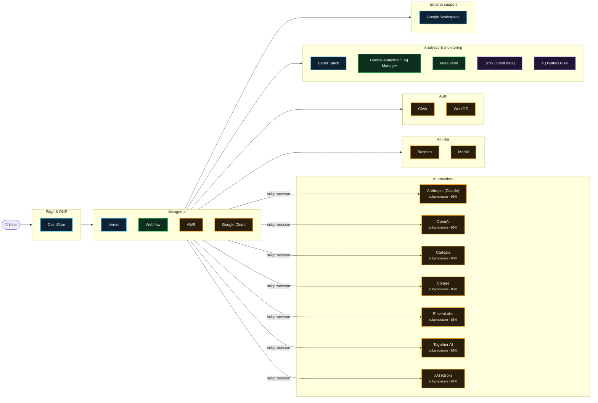

# What decagon.ai runs on

Scanned https://decagon.ai/ at 2026-10-15T04:53:21.586Z · 136 signals · 1.9 MB of JavaScript inspected

## AI providers

| Provider | Strongest evidence | Confidence | Models seen |
| --- | --- | --- | --- |
| Anthropic (Claude) | named on subprocessor, trust or status page | 95% | — |
| OpenAI | named on subprocessor, trust or status page | 95% | — |
| Cartesia | named on subprocessor, trust or status page | 85% | — |
| Cohere | named on subprocessor, trust or status page | 85% | — |
| ElevenLabs | named on subprocessor, trust or status page | 85% | — |
| Together AI | named on subprocessor, trust or status page | 85% | — |
| xAI (Grok) | named on subprocessor, trust or status page | 85% | — |

## Edge & DNS

- **Cloudflare** — infra, 99%

## App

- **Vercel** — infra, 99%
- **Webflow** — live, 99%
- **AWS** — subprocessor, 85%
- **Google Cloud** — subprocessor, 85%

## AI infra

- **Baseten** — subprocessor, 85%
- **Modal** — subprocessor, 85%

## Auth

- **Clerk** — subprocessor, 94%
- **WorkOS** — subprocessor, 85%

## Analytics & monitoring

- **Better Stack** — infra, 99%
- **Google Analytics / Tag Manager** — live, 99%
- **Meta Pixel** — live, 99%
- **Unify (intent data)** — in bundle, 88%
- **X (Twitter) Pixel** — in bundle, 70%

## Email & support

- **Google Workspace** — infra, 90%

## Team tools (from DNS verification records)

Box · Rippling · Zoom

## Evidence

<b>Better Stack</b> · monitoring · 99%

- `infra` dns-cname @ status.decagon.ai: `statuspage.betteruptime.com`
- `infra` dns-cname @ status.decagon.ai: `statuspage.betteruptime.com`
- `declared` status @ https://status.decagon.ai/: `…d. 2 previous updates Previous updates Powered by Better Stack`

<b>Cloudflare</b> · edge · 99%

- `infra` dns-ns @ decagon.ai: `carla.ns.cloudflare.com`
- `infra` dns-ns @ decagon.ai: `pranab.ns.cloudflare.com`
- `infra` header @ https://decagon.ai/: `cf-ray: a4ac383c0d4ad4bc-BOM`
- `infra` cookie @ https://decagon.ai/: `_cfuvid`
- `declared` subprocessors @ https://trust.decagon.ai/subprocessors: `…analytics US, Netherlands https://clickhouse.com Cloudflare Network security, DDoS prevention, caching Cloud…`

<b>Google Analytics / Tag Manager</b> · analytics · 99%

- `observed` html @ https://decagon.ai/: `…re(j,f); })(window,document,'script','dataLayer','GTM-KGGJWVL8');</script> <!-- End Google Tag Manager --> <scr…`
- `observed` resource @ https://www.googletagmanager.com/ns.html?id=GTM-KGGJWVL8: `www.googletagmanager.com`
- `bundle` bundle @ javascript bundles: `…ataLayer'?'&l='+l:'';j.async=true;j.src= 'https://www.googletagmanager.com/gtm.js?id='+i+dl;f.parentNode.insertBefore(j,f);…`
- `mention` legal @ https://decagon.ai/legal/privacy: `…op new products and services. For example, we use Google Analytics for this purpose. You can learn more about Google…`

<b>Meta Pixel</b> · analytics · 99%

- `observed` html @ https://decagon.ai/: `…https://connect.facebook.net/en_US/fbevents.js'); fbq('init', '1596965764728493'); fbq('track', 'PageView'); <…`
- `bundle` bundle @ javascript bundles: `…tBefore(t,s)}(window, document,'script', 'https://connect.facebook.net/en_US/fbevents.js'); fbq('init', '159696576472849…`
- `config` csp @ https://decagon.ai/: `connect.facebook.net`

<b>Vercel</b> · hosting · 99%

- `infra` dns-cname @ docs.decagon.ai: `cname.vercel-dns.com`
- `infra` header @ https://decagon.ai/: `x-vercel-id: bom1::v9rbh-1792040001906-85b777fef298`
- `infra` header @ https://chat.decagon.ai/: `x-vercel-id: bom1::25gsh-1792040002198-dee0e22a434b`
- `infra` header @ https://decagon.ai/: `server: Vercel`
- `infra` header @ https://decagon.ai/: `x-vercel-cache: MISS`
- `declared` subprocessors @ https://trust.decagon.ai/subprocessors: `…services US Large Language Model and AI services Vercel • Infrastructure Provider providing hosting servi…`

<b>Webflow</b> · hosting · 99%

- `observed` html @ https://decagon.ai/: `…cagon.ai" data-wf-page="696132ff8ea6626d06f7233f" data-wf-site="683e5da0b6d8a19de4875ae7" data-wf-intellimize-cus…`
- `observed` html @ https://decagon.ai/: `…me) --><html data-wf-domain="webflow2.decagon.ai" data-wf-page="696132ff8ea6626d06f7233f" data-wf-site="683e5da0b…`
- `observed` resource @ https://cdn.prod.website-files.com/683e5da0b6d8a19de4875ae7/69b0183908d0adf79336e11d_app.js.txt: `cdn.prod.website-files.com`
- `bundle` bundle @ javascript bundles: `…"@type": "ImageObject", "url": "https://cdn.prod.website-files.com/683e5da0b6d8a19de4875ae7/683e5da0b6d8a19de4875b4d…`
- `config` csp @ https://decagon.ai/: `cdn.prod.website-files.com`

<b>Anthropic (Claude)</b> · ai-provider · 95%

> An anthropic-domain-verification TXT record proves a Claude/Anthropic Console account, not that the product calls the API.

- `declared` subprocessors @ https://trust.decagon.ai/subprocessors: `…e Provider providing hosting services and storage Anthropic PBC • Large Language Model and AI services US, EU…`
- `mention` legal @ https://decagon.ai/security: `…a retention with all AI providers like OpenAI and Anthropic, ensuring no conversation data is stored or used…`
- `account` dns-txt @ decagon.ai: `anthropic-domain-verification-37bjg7=qNxmwguC2VTT9pWEE602fcAn3`
- `account` dns-txt @ decagon.ai: `anthropic-domain-verification-kjhj8d=qttGkXAhCoZTqDfdSyLk5IBTP`

<b>OpenAI</b> · ai-provider · 95%

> An openai-domain-verification TXT record proves an OpenAI account (often ChatGPT Enterprise), not that the product calls the API.

- `declared` subprocessors @ https://trust.decagon.ai/: `…oviding hosting services, storage and AI services OpenAI • Large Language Model and AI services US, EU Lar…`
- `mention` legal @ https://decagon.ai/security: `…es zero-data retention with all AI providers like OpenAI and Anthropic, ensuring no conversation data is s…`
- `account` dns-txt @ decagon.ai: `openai-domain-verification=dv-CETzbBKvTPtt2t5kWlDjhrWl`

<b>Clerk</b> · auth · 94%

- `declared` subprocessors @ https://trust.decagon.ai/subprocessors: `…der Authentication and SSO provider US workos.com Clerk Authentication and SSO provider Authentication an…`
- `config` csp @ https://decagon.ai/: `refined-ringtail-70.clerk.accounts.dev`
- `config` csp @ https://decagon.ai/: `refined-ringtail-70.clerk.accounts.dev`
- `config` csp @ https://decagon.ai/: `img.clerk.com`

<b>Google Workspace</b> · email · 90%

- `infra` dns-txt @ decagon.ai: `v=spf1 include:242175952.spf07.hubspotemail.net include:_spf.google.com -all`
- `infra` dns-mx @ decagon.ai: `smtp.google.com`

<b>Unify (intent data)</b> · analytics · 88%

- `bundle` bundle @ javascript bundles: `…script");n.async=!0,n.setAttribute("src","https://tag.unifyintent.com/v1/Vk7B6gLexcTQRCkuqpsnpy/script.js"),n.setAttrib…`
- `config` csp @ https://decagon.ai/: `tag.unifyintent.com`

<b>AWS</b> · hosting · 85%

- `declared` subprocessors @ https://trust.decagon.ai/: `…ices US, EU Large language models and AI provider Amazon Web Services • Cloud provider US, EU Infrastructure Provider p…`

<b>Baseten</b> · ai-infra · 85%

- `declared` subprocessors @ https://trust.decagon.ai/subprocessors: `…Text-to-speech AI services US https://cartesia.ai Baseten LLM Model Finetuning Model hosting provider US, E…`

<b>Cartesia</b> · ai-provider · 85%

- `declared` subprocessors @ https://trust.decagon.ai/subprocessors: `…ech AI services Text-to-speech AI services US, EU Cartesia Text-to-speech AI services Text-to-speech AI serv…`

<b>Cohere</b> · ai-provider · 85%

- `declared` subprocessors @ https://trust.decagon.ai/subprocessors: `…vices US, EU Large Language Model and AI services Cohere Inc. • Large Language Model and AI services US Large…`

<b>ElevenLabs</b> · ai-provider · 85%

- `declared` subprocessors @ https://trust.decagon.ai/subprocessors: `…ovider providing hosting services and AI services ElevenLabs • Text-to-speech AI services US, EU Text-to-speec…`

<b>Google Cloud</b> · hosting · 85%

- `declared` subprocessors @ https://trust.decagon.ai/: `…ication policy established Subprocessors View all Google Cloud Platform • Cloud hosting provider US, EU Infrastructure Pr…`
- `declared` subprocessors @ https://trust.decagon.ai/subprocessors: `…ew tab Request access Subprocessors Subprocessors Google Cloud Platform • Cloud hosting provider US, EU Infrastructure Pr…`

<b>Modal</b> · ai-infra · 85%

- `declared` subprocessors @ https://trust.decagon.ai/subprocessors: `…el hosting provider US, EU https://www.baseten.co Modal Labs, Inc. LLM Model Finetuning Model hosting provider…`

<b>Together AI</b> · ai-provider · 85%

- `declared` subprocessors @ https://trust.decagon.ai/subprocessors: `…g Model hosting provider US, EU https://modal.com Together Computer Inc LLM Model Finetuning Model hosting provider U…`

<b>Vanta</b> · compliance · 85%

- `declared` subprocessors @ https://trust.decagon.ai/: `…of registration for Decagon, Issued on 2026-01-22 Vanta connects to a company's core systems to continuou…`

<b>WorkOS</b> · auth · 85%

- `declared` subprocessors @ https://trust.decagon.ai/subprocessors: `…ytics Business Data Analytics US https://hex.tech WorkOS Authentication and SSO provider Authentication an…`

<b>xAI (Grok)</b> · ai-provider · 85%

- `declared` subprocessors @ https://trust.decagon.ai/subprocessors: `…liance-restricted data US https://basistheory.com xAI Large language model and AI inference services Cl…`

<b>X (Twitter) Pixel</b> · analytics · 70%

- `bundle` bundle @ javascript bundles: `…[],u=t.createElement(n),u.async=!0,u.src='https://static.ads-twitter.com/uwt.js', a=t.getElementsByTagName(n)[0],a.parentN…`

<b>Okta</b> · auth · 45%

- `mention` legal @ https://decagon.ai/security: `…) Decagon integrates with identity providers like Okta and Microsoft Entra, enabling secure access acros…`

<b>Box</b> · team-tools · 35%

- `account` dns-txt @ decagon.ai: `box-domain-verification=55ac698ba43ed82e122b341e788a6e36b9d5aea17823f7d080a333ed4b190397`

<b>Microsoft 365</b> · email · 35%

- `account` dns-txt @ decagon.ai: `MS=ms21388169`

<b>Rippling</b> · team-tools · 35%

- `account` dns-txt @ decagon.ai: `rippling-domain-verification=4ca48d2d49e3e5b5`

<b>Zoom</b> · team-tools · 35%

- `account` dns-txt @ decagon.ai: `ZOOM_verify_mMwrUTsz7jvbioBfNs72u5`

## Limitations

- This is an outside-in scan. Calls a backend makes to an LLM API never touch the browser, so they only show up if the company declares them (subprocessor list, trust center, status page) or ships references in client code.
- `DNS account` evidence means the company verified its domain with that vendor. That often means employees use it (e.g. ChatGPT Enterprise, Claude for Work), not that the product calls it.
- `in bundle` means shipped JavaScript references the vendor or model id. Model pickers and marketing pages can mention models that are routed through another provider.
- Run with `--rea` to add live network observation through REA (github.com/morluto/rea).
