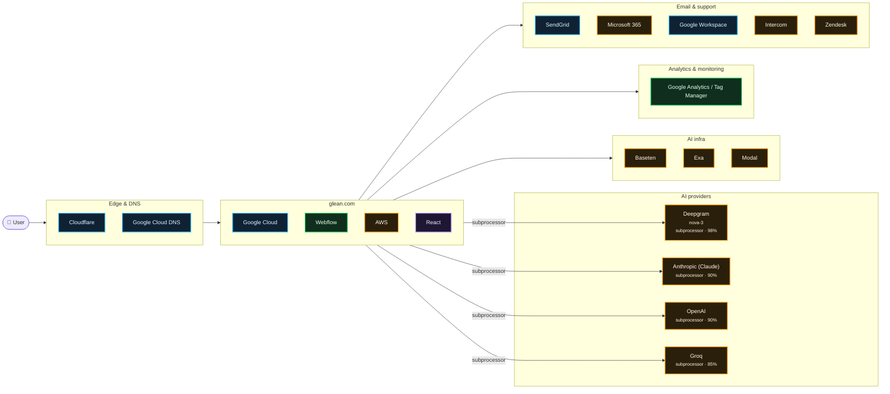

# What glean.com runs on

Scanned https://www.glean.com/ at 2026-10-15T04:53:42.795Z · 285 signals · 4.0 MB of JavaScript inspected

## AI providers

| Provider | Strongest evidence | Confidence | Models seen |
| --- | --- | --- | --- |
| Deepgram | named on subprocessor, trust or status page | 98% | nova-3 |
| Anthropic (Claude) | named on subprocessor, trust or status page | 90% | — |
| OpenAI | named on subprocessor, trust or status page | 90% | — |
| Groq | named on subprocessor, trust or status page | 85% | — |

## Edge & DNS

- **Cloudflare** — infra, 90%
- **Google Cloud DNS** — infra, 90%

## App

- **Google Cloud** — infra, 99%
- **Webflow** — live, 99%
- **AWS** — subprocessor, 85%
- **React** — in bundle, 70%

## AI infra

- **Baseten** — subprocessor, 85%
- **Exa** — subprocessor, 85%
- **Modal** — subprocessor, 85%

## Analytics & monitoring

- **Google Analytics / Tag Manager** — live, 99%

## Email & support

- **SendGrid** — infra, 99%
- **Microsoft 365** — subprocessor, 95%
- **Google Workspace** — infra, 90%
- **Intercom** — subprocessor, 85%
- **Zendesk** — subprocessor, 85%

## Team tools (from DNS verification records)

Adobe · Apple Business · Box · Cursor · Figma · Jamf · Linear · Wiz · Zoom

## Evidence

<b>Google Analytics / Tag Manager</b> · analytics · 99%

- `observed` html @ https://www.glean.com/: `…re(j,f); })(window,document,'script','dataLayer','GTM-MN2WW79');</script> <!-- End Google Tag Manager --> <!-…`
- `observed` resource @ https://www.googletagmanager.com/ns.html?id=GTM-MN2WW79: `www.googletagmanager.com`
- `bundle` bundle @ javascript bundles: `…ataLayer'?'&l='+l:'';j.async=true;j.src= 'https://www.googletagmanager.com/gtm.js?id='+i+dl;f.parentNode.insertBefore(j,f);…`

<b>Google Cloud</b> · hosting · 99%

- `infra` header @ https://app.glean.com/: `server: Google Frontend`
- `infra` header @ https://app.glean.com/: `via: 1.1 google`
- `infra` header @ https://app.glean.com/: `x-cloud-trace-context: 55fef53b0a117d4ffd734ac7efd8295b`
- `infra` header @ https://app.glean.com/chat/: `x-cloud-trace-context: f45ec4615b4b553efd734ac7efd82dd2`
- `declared` subprocessors @ https://trust.glean.com/: `…s and Responsibilities Glean CAIQv4 Questionnaire GCP View 4 more Controls Updated 21 minutes ago View…`

<b>SendGrid</b> · email · 99%

- `infra` dns-txt @ glean.com: `v=spf1 include:_spf.google.com include:mktomail.com include:mail.zendesk.com include:sendgrid.net ~all`
- `declared` subprocessors @ https://www.glean.com/legal/subprocessors: `…ndesk, Inc. Customer Support Portal United States SendGrid, Inc. Email Provider United States Anthropic PBC…`

<b>Vanta</b> · compliance · 99%

- `infra` dns-cname @ trust.glean.com: `6759c7e31d0bd0c2047760f0.cname.vantatrust.com`
- `declared` subprocessors @ https://trust.glean.com/: `…updates FAQ around data security and data privacy Vanta connects to a company's core systems to continuou…`

<b>Webflow</b> · hosting · 99%

- `observed` html @ https://www.glean.com/: `…lean.com" data-wf-page="66aa20b1490d471f6dcb2ea3" data-wf-site="6127a84dfe068e153ef20572" lang="en-US"><head><met…`
- `observed` html @ https://www.glean.com/: `…sal Time) --><html data-wf-domain="www.glean.com" data-wf-page="66aa20b1490d471f6dcb2ea3" data-wf-site="6127a84df…`
- `observed` resource @ https://cdn.prod.website-files.com/6127a84dfe068e153ef20572/js/staging-glean.0eb026ab.a8550a22c849b725.js: `cdn.prod.website-files.com`
- `bundle` bundle @ javascript bundles: `…rl": "https://www.glean.com/", "logo": "https://assets-global.website-files.com/6127a84dfe068e153ef20572/63f382fd40bd5b4e4e92b242…`

<b>Deepgram</b> · ai-provider · 98%

- `declared` subprocessors @ https://www.glean.com/legal/subprocessors: `…States Brave Software, Inc. Search United States Deepgram, Inc. Speech-to-text transcription United States*…`
- `declared` subprocessors @ https://trust.glean.com/subprocessors: `…wling and rendering United States https://exa.ai/ Deepgram, Inc. Speech-to-text transcription United States…`
- `bundle` bundle @ javascript bundles: `nova-3`
- `config` csp @ https://app.glean.com/: `api.deepgram.com`

<b>Microsoft 365</b> · email · 95%

- `declared` subprocessors @ https://www.glean.com/legal/subprocessors: `…alternatives Glean vs ChatGPT Enterprise Glean vs Microsoft 365 Copilot Glean vs Claude Enterprise Resources Cont…`
- `mention` legal @ https://www.glean.com/platform/security: `…alternatives Glean vs ChatGPT Enterprise Glean vs Microsoft 365 Copilot Glean vs Claude Enterprise Resources Cont…`
- `account` dns-txt @ glean.com: `MS=ms13782735`

<b>Osano</b> · compliance · 95%

- `observed` resource @ https://cmp.osano.com/16CXuzUWVmvBc5GOi/2cb189d0-529f-40a5-9353-12a933c5cb8e/osano.js: `cmp.osano.com`

<b>Anthropic (Claude)</b> · ai-provider · 90%

> An anthropic-domain-verification TXT record proves a Claude/Anthropic Console account, not that the product calls the API.

- `declared` subprocessors @ https://www.glean.com/legal/subprocessors: `…tates SendGrid, Inc. Email Provider United States Anthropic PBC LLM Provider United States Baseten Labs, Inc.…`
- `declared` subprocessors @ https://trust.glean.com/subprocessors: `…ates Sendgrid, Inc • Email Provider United States Anthropic PBC • LLM Provider United States 1-10 of 18 resul…`
- `account` dns-txt @ glean.com: `anthropic-domain-verification-ctpx8q=6BVNBWymVeBpeTHb55ob95sBg`

<b>Cloudflare</b> · edge · 90%

- `infra` header @ https://www.glean.com/: `server: cloudflare`
- `infra` header @ https://www.glean.com/: `cf-ray: a4ac38c5298e83f3-BLR`
- `infra` cookie @ https://www.glean.com/: `_cfuvid`

<b>Google Cloud DNS</b> · edge · 90%

- `infra` dns-ns @ glean.com: `ns-cloud-b4.googledomains.com`
- `infra` dns-ns @ glean.com: `ns-cloud-b3.googledomains.com`
- `infra` dns-ns @ glean.com: `ns-cloud-b2.googledomains.com`
- `infra` dns-ns @ glean.com: `ns-cloud-b1.googledomains.com`

<b>Google Workspace</b> · email · 90%

- `infra` dns-txt @ glean.com: `v=spf1 include:_spf.google.com include:mktomail.com include:mail.zendesk.com include:sendgrid.net ~all`
- `infra` dns-mx @ glean.com: `aspmx.l.google.com`
- `infra` dns-mx @ glean.com: `alt3.aspmx.l.google.com`
- `infra` dns-mx @ glean.com: `alt2.aspmx.l.google.com`
- `infra` dns-mx @ glean.com: `alt4.aspmx.l.google.com`
- `infra` dns-mx @ glean.com: `alt1.aspmx.l.google.com`

<b>OpenAI</b> · ai-provider · 90%

> An openai-domain-verification TXT record proves an OpenAI account (often ChatGPT Enterprise), not that the product calls the API.

- `declared` subprocessors @ https://www.glean.com/legal/subprocessors: `…tates Modal Labs, Inc. LLM Provider United States OpenAI OpCo, LLC LLM Provider United States Snowflake, I…`
- `declared` subprocessors @ https://trust.glean.com/subprocessors: `…Inc. LLM Provider United States https://groq.com/ OpenAI OpCo, LLC LLM Provider United States https://open…`
- `account` dns-txt @ glean.com: `openai-domain-verification=dv-F4GFzqSQvLiknoAbHPmZVpV0`
- `account` dns-txt @ glean.com: `openai-domain-verification=dv-Zltmgx6Di8WrDpv7jErJK56k`

<b>AWS</b> · hosting · 85%

- `declared` subprocessors @ https://www.glean.com/legal/subprocessors: `…ovider (Prisma AI Runtime Security) United States Amazon Web Services, Inc. Cloud Service Provider / LLM Provider Unite…`
- `declared` subprocessors @ https://trust.glean.com/subprocessors: `…oogle LLC • Cloud Service Provider / LLM Provider Amazon Web Services • Cloud Service Provider / LLM Provider This is a…`
- `declared` subprocessors @ https://trust.glean.com/subprocessors: `…nal sub-processor for customers who choose to use AWS. Microsoft Corporation • Cloud Service Provider /…`

<b>Baseten</b> · ai-infra · 85%

- `declared` subprocessors @ https://www.glean.com/legal/subprocessors: `…d States Anthropic PBC LLM Provider United States Baseten Labs, Inc. LLM Provider United States Fireworks.a…`

<b>Exa</b> · ai-infra · 85%

- `declared` subprocessors @ https://www.glean.com/legal/subprocessors: `…Inc. Speech-to-text transcription United States** Exa Labs, Inc. Web crawling and rendering United States *C…`
- `declared` subprocessors @ https://trust.glean.com/subprocessors: `…vider United States https://www.snowflake.com/en/ Exa Labs, Inc. Web crawling and rendering United States ht…`

<b>Groq</b> · ai-provider · 85%

- `declared` subprocessors @ https://www.glean.com/legal/subprocessors: `…tes Fireworks.ai, Inc. LLM Provider United States Groq, Inc. LLM Provider United States Modal Labs, Inc.…`
- `declared` subprocessors @ https://trust.glean.com/subprocessors: `…works.ai, Inc. LLM Provider https://fireworks.ai/ Groq Inc. LLM Provider United States https://groq.com/…`

<b>Intercom</b> · support · 85%

- `declared` subprocessors @ https://www.glean.com/legal/subprocessors: `…ud Service Provider / LLM Provider United States* Intercom, Inc. Cloud-based Customer Support Services Unite…`
- `declared` subprocessors @ https://trust.glean.com/subprocessors: `…rporation • Cloud Service Provider / LLM Provider Intercom, Inc. • Cloud-based Customer Support Services Uni…`

<b>Modal</b> · ai-infra · 85%

- `declared` subprocessors @ https://www.glean.com/legal/subprocessors: `…ited States Groq, Inc. LLM Provider United States Modal Labs, Inc. LLM Provider United States OpenAI OpCo, LLC…`

<b>Zendesk</b> · support · 85%

- `declared` subprocessors @ https://www.glean.com/legal/subprocessors: `…logies, LLC Customer Communications United States Zendesk, Inc. Customer Support Portal United States SendG…`
- `declared` subprocessors @ https://trust.glean.com/subprocessors: `…gies, LLC • Customer Communications United States Zendesk Inc. • Customer Support Portal United States Send…`

<b>React</b> · framework · 70%

- `bundle` bundle @ javascript bundles: `…ll}var ny=Math.random().toString(36).slice(2),nH="__reactFiber$"+ny,nP="__reactProps$"+ny,nD="__reactContainer$"+…`
- `bundle` bundle @ javascript bundles: `…),nH="__reactFiber$"+ny,nP="__reactProps$"+ny,nD="__reactContainer$"+ny,nU="__reactEvents$"+ny,nL="__reactListeners$"…`
- `bundle` bundle @ javascript bundles: `…ECRET_INTERNALS_DO_NOT_USE_OR_YOU_WILL_BE_FIRED,b=Symbol.for("react.element"),y=Symbol.for("react.portal"),H=Symbol.for("react.…`

<b>Adobe</b> · team-tools · 35%

- `account` dns-txt @ glean.com: `adobe-idp-site-verification=1467f9a888c18fa87e2f6351bc4fef51b80cc0d8c61b048fc2a930dc14fe81c4`

<b>Apple Business</b> · team-tools · 35%

- `account` dns-txt @ glean.com: `apple-domain-verification=gz039c6RC4VRILk7`

<b>Box</b> · team-tools · 35%

- `account` dns-txt @ glean.com: `box-domain-verification=81402322fc57cfb02af2ce0a497c0f2926dc9359034df836998f52feb608a4c3`

<b>Cursor</b> · team-tools · 35%

- `account` dns-txt @ glean.com: `cursor-domain-verification-xntkvq=XBoHwqJ1FbHGHMoCIASbOTNAK`

<b>Figma</b> · team-tools · 35%

- `account` dns-txt @ glean.com: `figma-domain-verification=9f2efeee6666f7e49ca1d6322cdec2a8ece7ea03b3b6ae4d5e1b6229c8f37129-1762692463`

<b>HubSpot</b> · analytics · 35%

- `account` dns-txt @ glean.com: `hubspot-developer-verification=MWYwNjUyN2EtOWZjMS00ZDUyLThiMjEtOTI2MmE5MThiZjFi`

<b>Jamf</b> · team-tools · 35%

- `account` dns-txt @ glean.com: `jamf-site-verification=z2_XUp6Ny7_S1b0qbsPjnA`

<b>Linear</b> · team-tools · 35%

- `account` dns-txt @ glean.com: `linear-domain-verification=6fp9r8c8jexi`

<b>Wiz</b> · team-tools · 35%

- `account` dns-txt @ glean.com: `wiz-domain-verification=e2f76216b720bd20bd8723fa7b0b038ba7c7f691229d24f3f646f31cbbd44283`

<b>Zoom</b> · team-tools · 35%

- `account` dns-txt @ glean.com: `zoom-domain-verification=487033b4-fbad-45ea-b6df-81b178f019fd`

## Limitations

- This is an outside-in scan. Calls a backend makes to an LLM API never touch the browser, so they only show up if the company declares them (subprocessor list, trust center, status page) or ships references in client code.
- `DNS account` evidence means the company verified its domain with that vendor. That often means employees use it (e.g. ChatGPT Enterprise, Claude for Work), not that the product calls it.
- `in bundle` means shipped JavaScript references the vendor or model id. Model pickers and marketing pages can mention models that are routed through another provider.
- Run with `--rea` to add live network observation through REA (github.com/morluto/rea).
