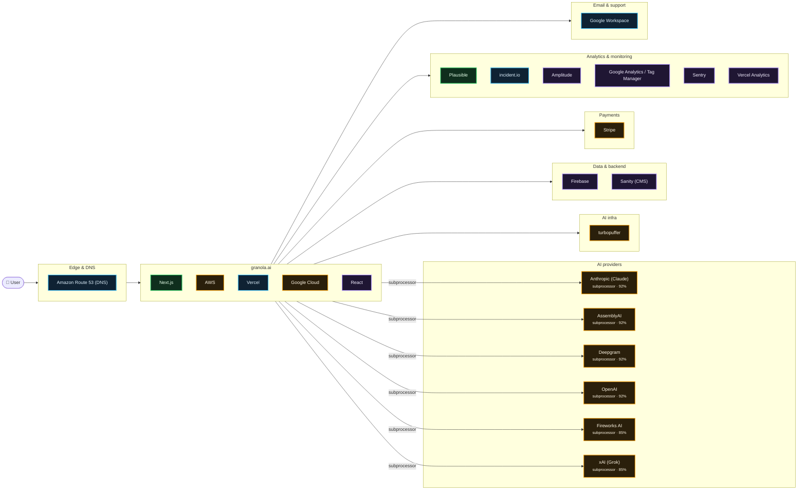

# What granola.ai runs on

Scanned https://www.granola.ai/ at 2026-10-15T04:54:49.631Z · 97 signals · 3.8 MB of JavaScript inspected

## AI providers

| Provider | Strongest evidence | Confidence | Models seen |
| --- | --- | --- | --- |
| Anthropic (Claude) | named on subprocessor, trust or status page | 92% | — |
| AssemblyAI | named on subprocessor, trust or status page | 92% | — |
| Deepgram | named on subprocessor, trust or status page | 92% | — |
| OpenAI | named on subprocessor, trust or status page | 92% | — |
| Fireworks AI | named on subprocessor, trust or status page | 85% | — |
| xAI (Grok) | named on subprocessor, trust or status page | 85% | — |

## Edge & DNS

- **Amazon Route 53 (DNS)** — infra, 90%

## App

- **Next.js** — live, 99%
- **AWS** — subprocessor, 92%
- **Vercel** — infra, 90%
- **Google Cloud** — subprocessor, 85%
- **React** — in bundle, 70%

## AI infra

- **turbopuffer** — subprocessor, 85%

## Data & backend

- **Firebase** — in bundle, 70%
- **Sanity (CMS)** — in bundle, 70%

## Payments

- **Stripe** — subprocessor, 92%

## Analytics & monitoring

- **Plausible** — live, 99%
- **incident.io** — infra, 90%
- **Amplitude** — in bundle, 70%
- **Google Analytics / Tag Manager** — in bundle, 70%
- **Sentry** — in bundle, 70%
- **Vercel Analytics** — in bundle, 70%

## Email & support

- **Google Workspace** — infra, 95%

## Evidence

<b>Next.js</b> · framework · 99%

- `observed` html @ https://www.granola.ai/: `…h, initial-scale=1"/><link rel="stylesheet" href="/_next/static/css/c0f4713c5af5fbcf.css" data-precedence="next"/>…`
- `observed` html @ https://www.granola.ai/: `…">
<script>self…`
- `infra` header @ https://www.granola.ai/: `x-powered-by: Next.js`
- `infra` header @ https://www.granola.ai/: `x-matched-path: /`

<b>Plausible</b> · analytics · 99%

- `observed` resource @ https://plausible.io/js/script.tagged-events.outbound-links.js: `plausible.io`
- `bundle` bundle @ javascript bundles: `…,\"data-domain\":\"granola.so\",\"src\":\"https://plausible.io/js/script.tagged-events.outbound-links.js\"}],[\"…`

<b>Vanta</b> · compliance · 99%

- `infra` dns-cname @ trust.granola.ai: `670679383b07d97110d2a41a.cname.vantatrust.com`
- `declared` subprocessors @ https://trust.granola.ai/: `…ribe to updates Granola SOC 2 Type II Report 2025 Vanta connects to a company's core systems to continuou…`

<b>Google Workspace</b> · email · 95%

- `infra` dns-txt @ granola.ai: `v=spf1 include:_spf.google.com ~all`
- `infra` dns-mx @ granola.ai: `smtp.google.com`
- `mention` legal @ https://www.granola.ai/security: `…, a lot like Apple Notes or Notion. It works with Google Workspace or Microsoft login and integrates with your calen…`
- `mention` legal @ https://docs.granola.ai/help-center/policies/privacy-policy: `…Google Accounts Workspace Auto-Join Post-Mortem: Google Workspace Session Logout Vulnerability Security Contributio…`

<b>Anthropic (Claude)</b> · ai-provider · 92%

> An anthropic-domain-verification TXT record proves a Claude/Anthropic Console account, not that the product calls the API.

- `declared` subprocessors @ https://trust.granola.ai/subprocessors: `…Subscribe to updates Subprocessors Subprocessors Anthropic, PBC • AI Processing & Transcription United State…`
- `declared` subprocessors @ https://trust.granola.ai/: `…y identifiable information Subprocessors View all Anthropic, PBC • AI Processing & Transcription United State…`
- `mention` legal @ https://www.granola.ai/security: `…m and Assembly) and AI providers (like OpenAI and Anthropic) to summarize your meeting. Model training We do…`
- `mention` legal @ https://docs.granola.ai/help-center/policies/privacy-policy: `…: We do not allow third parties such as OpenAI or Anthropic to use your Personal Data to train AI models. We…`

<b>AssemblyAI</b> · ai-provider · 92%

- `declared` subprocessors @ https://trust.granola.ai/subprocessors: `…pliance measures – X AI Security Opens in new tab AssemblyAI, Inc. • AI Processing & Transcription United Stat…`
- `mention` legal @ https://docs.granola.ai/help-center/policies/privacy-policy: `…ight Dispute Policy Security Reports Post-Mortem: AssemblyAI API Key Exposure Post-Mortem: Legacy Unmanaged Go…`

<b>AWS</b> · hosting · 92%

- `declared` subprocessors @ https://trust.granola.ai/subprocessors: `…oogle Cloud Compliance Resources Opens in new tab Amazon Web Services • Infrastructure & Hosting United States Purpose…`
- `declared` subprocessors @ https://trust.granola.ai/subprocessors: `…Kennedy, L-1855 Luxembourg Compliance measures – AWS Compliance Programs Opens in new tab xAI • AI Pro…`
- `declared` subprocessors @ https://trust.granola.ai/: `…Kennedy, L-1855 Luxembourg Compliance measures – AWS Compliance Programs Opens in new tab Updates View…`
- `mention` legal @ https://docs.granola.ai/help-center/policies/privacy-policy: `…ed-out by default. We store your Personal Data in Amazon Web Services (“AWS”) servers located in the U.S. All Personal…`
- `mention` legal @ https://www.granola.ai/security: `…infrastructure Notes are stored in our US-hosted AWS Virtual Private Cloud. They are encrypted at rest…`
- `mention` legal @ https://docs.granola.ai/help-center/policies/privacy-policy: `…store your Personal Data in Amazon Web Services (“AWS”) servers located in the U.S. All Personal Data i…`

<b>Deepgram</b> · ai-provider · 92%

- `declared` subprocessors @ https://trust.granola.ai/subprocessors: `…e measures – AssemblyAI Security Opens in new tab Deepgram • AI Processing & Transcription United States Pur…`
- `mention` legal @ https://www.granola.ai/security: `…uses best-in-class transcription providers (like Deepgram and Assembly) and AI providers (like OpenAI and A…`

<b>OpenAI</b> · ai-provider · 92%

> An openai-domain-verification TXT record proves an OpenAI account (often ChatGPT Enterprise), not that the product calls the API.

- `declared` subprocessors @ https://trust.granola.ai/subprocessors: `…easures – Anthropic Trust Center Opens in new tab OpenAI • AI Processing & Transcription United States Pur…`
- `mention` legal @ https://www.granola.ai/security: `…ike Deepgram and Assembly) and AI providers (like OpenAI and Anthropic) to summarize your meeting. Model t…`
- `mention` legal @ https://docs.granola.ai/help-center/policies/privacy-policy: `…ou to know: We do not allow third parties such as OpenAI or Anthropic to use your Personal Data to train A…`

<b>Stripe</b> · payments · 92%

- `declared` subprocessors @ https://trust.granola.ai/subprocessors: `…Braintrust Security & Compliance Opens in new tab Stripe, Inc. • Operations & Support United States Purpose of…`
- `mention` legal @ https://docs.granola.ai/help-center/policies/privacy-policy: `…fically our payment processing partner, currently Stripe, Inc.) Device/IP Data • IP address • IP-address-based…`

<b>Amazon Route 53 (DNS)</b> · edge · 90%

- `infra` dns-ns @ granola.ai: `ns-845.awsdns-41.net`
- `infra` dns-ns @ granola.ai: `ns-1255.awsdns-28.org`
- `infra` dns-ns @ granola.ai: `ns-1786.awsdns-31.co.uk`
- `infra` dns-ns @ granola.ai: `ns-241.awsdns-30.com`

<b>incident.io</b> · monitoring · 90%

- `infra` dns-cname @ status.granola.ai: `statuspage.incident.io`

<b>Vercel</b> · hosting · 90%

- `infra` dns-cname @ www.granola.ai: `cname.vercel-dns.com`
- `infra` header @ https://www.granola.ai/: `x-vercel-id: bom1::iad1::cgzmc-1792040089942-cb380cb808ce`
- `infra` header @ https://www.granola.ai/: `server: Vercel`
- `infra` header @ https://www.granola.ai/: `x-vercel-cache: MISS`

<b>Fireworks AI</b> · ai-provider · 85%

- `declared` subprocessors @ https://trust.granola.ai/subprocessors: `…od City, CA 94063, USA **Compliance measures** – [Fireworks AI Trust Center](https://trust.fireworks.ai/) AI Pro…`

<b>Google Cloud</b> · hosting · 85%

- `declared` subprocessors @ https://trust.granola.ai/subprocessors: `…nce measures – OpenAI Compliance Opens in new tab Google Cloud • AI Processing & Transcription United States Pur…`

<b>turbopuffer</b> · ai-infra · 85%

- `declared` subprocessors @ https://trust.granola.ai/subprocessors: `…essing & Transcription United States fireworks.ai Turbopuffer **Purpose of processing** – Vector search and emb…`

<b>xAI (Grok)</b> · ai-provider · 85%

- `declared` subprocessors @ https://trust.granola.ai/subprocessors: `…asures – AWS Compliance Programs Opens in new tab xAI • AI Processing & Transcription United States Pur…`

<b>Amplitude</b> · analytics · 70%

- `bundle` bundle @ javascript bundles: `…"AMP","_unsent"),k="$default_instance",T="https://api2.amplitude.com/2/httpapi",_=function(){return{flushMaxRetries:12…`
- `bundle` bundle @ javascript bundles: `…n{serverZone:i,serverUrl:(r=n,"EU"===i?r?"https://api.eu.amplitude.com/batch":"https://api.eu.amplitude.com/2/httpapi":r…`

<b>Firebase</b> · backend · 70%

- `bundle` bundle @ javascript bundles: `…cn","edu.hk","edu.sg","edu.th","edu.tr","edu.tw","firebaseapp.com","fly.dev","gc.ca","geek.nz","github.io","gitlab.i…`

<b>Google Analytics / Tag Manager</b> · analytics · 70%

- `bundle` bundle @ javascript bundles: `…le.com/analytics/web/","scripts":[{"url":"https://www.googletagmanager.com/gtag/js","params":["id"],"strategy":"worker","loc…`

<b>React</b> · framework · 70%

- `bundle` bundle @ javascript bundles: `…t}}var eA=Math.random().toString(36).slice(2),eR="__reactFiber$"+eA,eI="__reactProps$"+eA,eU="__reactContainer$"+…`
- `bundle` bundle @ javascript bundles: `…),eR="__reactFiber$"+eA,eI="__reactProps$"+eA,eU="__reactContainer$"+eA,e$="__reactEvents$"+eA,ej="__reactListeners$"…`
- `bundle` bundle @ javascript bundles: `…ssign,h=Symbol.for("react.element"),g=Symbol.for("react.transitional.element"),y=Symbol.for("react.portal"),v=Symbol.for("reac…`
- `bundle` bundle @ javascript bundles: `…(e)!==e)throw Error(i(188))}var m=Object.assign,h=Symbol.for("react.element"),g=Symbol.for("react.transitional.element"),y=Symb…`

<b>Sanity (CMS)</b> · backend · 70%

- `bundle` bundle @ javascript bundles: `…split("://",2),d=l[0],h=l[1],p=s.isDefaultApi?"apicdn.sanity.io":h;return o?(s.url='${d}://${s.projectId}.${h}/v$…`

<b>Sentry</b> · monitoring · 70%

- `bundle` bundle @ javascript bundles: `…sN({dsn:"https://52cfb921b4c29a142972c19448181de3@o4506028222513152.ingest.us.sentry.io/4510606199488512",tracesSampleRate:.05,enableLogs…`
- `bundle` bundle @ javascript bundles: `…"npm"){let a=e._metadata||{};a.sdk||(a.sdk={name:'sentry.javascript.${t}',packages:r.map(e=>({name:'${n}:@sentry/${e}'…`
- `bundle` bundle @ javascript bundles: `…ction o(){return i(a.O),a.O}function i(e){let t=e.__SENTRY__=e.__SENTRY__||{};return t.version=t.version||n.M,…`

<b>Vercel Analytics</b> · analytics · 70%

- `bundle` bundle @ javascript bundles: `…Send));let n=t.scriptSrc?t.scriptSrc:u()?"https://va.vercel-scripts.com/v1/script.debug.js":t.basePath?"".concat(t.basePa…`

<b>HubSpot</b> · analytics · 35%

- `account` dns-txt @ granola.ai: `hubspot-developer-verification=M2EyMzFkYTktNjFlNS00NDQ1LWExY2UtZTQ3NzUzNmI3YTUw`

<b>Microsoft 365</b> · email · 35%

- `account` dns-txt @ granola.ai: `MS=ms85192153`

## Limitations

- This is an outside-in scan. Calls a backend makes to an LLM API never touch the browser, so they only show up if the company declares them (subprocessor list, trust center, status page) or ships references in client code.
- `DNS account` evidence means the company verified its domain with that vendor. That often means employees use it (e.g. ChatGPT Enterprise, Claude for Work), not that the product calls it.
- `in bundle` means shipped JavaScript references the vendor or model id. Model pickers and marketing pages can mention models that are routed through another provider.
- Run with `--rea` to add live network observation through REA (github.com/morluto/rea).
