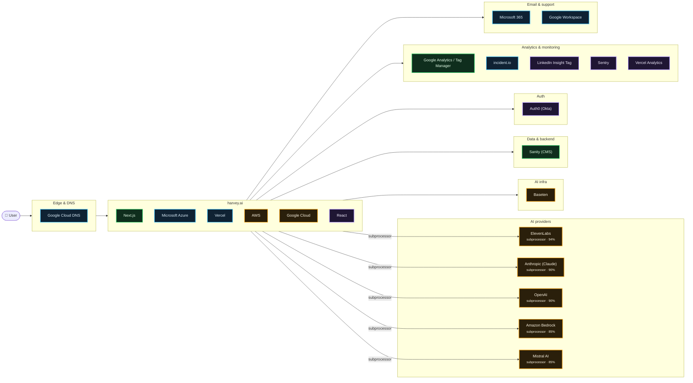

# What harvey.ai runs on

Scanned https://www.harvey.ai/ at 2026-10-15T04:52:50.836Z · 210 signals · 4.8 MB of JavaScript inspected

## AI providers

| Provider | Strongest evidence | Confidence | Models seen |
| --- | --- | --- | --- |
| ElevenLabs | named on subprocessor, trust or status page | 94% | — |
| Anthropic (Claude) | named on subprocessor, trust or status page | 90% | — |
| OpenAI | named on subprocessor, trust or status page | 90% | — |
| Amazon Bedrock | named on subprocessor, trust or status page | 85% | — |
| Mistral AI | named on subprocessor, trust or status page | 85% | — |

## Edge & DNS

- **Google Cloud DNS** — infra, 90%

## App

- **Next.js** — live, 99%
- **Microsoft Azure** — infra, 95%
- **Vercel** — infra, 90%
- **AWS** — subprocessor, 85%
- **Google Cloud** — subprocessor, 85%
- **React** — in bundle, 70%

## AI infra

- **Baseten** — subprocessor, 85%

## Data & backend

- **Sanity (CMS)** — live, 99%

## Auth

- **Auth0 (Okta)** — in bundle, 88%

## Analytics & monitoring

- **Google Analytics / Tag Manager** — live, 99%
- **incident.io** — infra, 90%
- **LinkedIn Insight Tag** — in bundle, 70%
- **Sentry** — in bundle, 70%
- **Vercel Analytics** — in bundle, 70%

## Email & support

- **Microsoft 365** — infra, 94%
- **Google Workspace** — infra, 90%

## Team tools (from DNS verification records)

Adobe · Airtable · Apple Business · Atlassian · Cursor · Figma · HackerOne · Jamf · Linear · Notion · Slack · Zoom

## Evidence

<b>Google Analytics / Tag Manager</b> · analytics · 99%

- `observed` html @ https://www.harvey.ai/: `…href="https://www.googletagmanager.com/gtm.js?id=GTM-KMXPZXTG" as="script"/><meta name="theme-color" content="#…`
- `observed` resource @ https://www.googletagmanager.com/gtm.js?id=GTM-KMXPZXTG: `www.googletagmanager.com`
- `bundle` bundle @ javascript bundles: `…),(0,s.jsx)(u.default,{id:"_next-ga",src:'https://www.googletagmanager.com/gtag/js?id=${t}',nonce:o})]})},r.sendGAEvent=func…`

<b>Next.js</b> · framework · 99%

- `observed` html @ https://www.harvey.ai/: `…idth, initial-scale=1"/><link rel="preload" href="/_next/static/immutable/media/HarveySansDiatypeVariable-s.p.2rrv…`
- `observed` html @ https://www.harvey.ai/: `…y732oke1o.js" id="_R_" async=""></script><script>self…`
- `infra` header @ https://www.harvey.ai/: `x-nextjs-prerender: 1`
- `infra` header @ https://www.harvey.ai/: `x-nextjs-stale-time: 300`
- `infra` header @ https://www.harvey.ai/: `x-matched-path: /en-US`

<b>Sanity (CMS)</b> · backend · 99%

- `observed` resource @ https://cdn.sanity.io/images/07s0r5r6/production/6d697d9a97bf529af75a9380d4de4b99e101c77e-2740x1542.svg: `cdn.sanity.io`
- `bundle` bundle @ javascript bundles: `…mageOfPage":{"@type":"ImageObject","url":"https://cdn.sanity.io/images/07s0r5r6/production/acf4a0772c068016f3d331…`

<b>Microsoft Azure</b> · hosting · 95%

- `infra` dns-cname @ api.harvey.ai: `traffic-manager-profile-backend-prod.trafficmanager.net`
- `infra` dns-cname @ app.harvey.ai: `traffic-manager-profile-frontend-prod.trafficmanager.net`
- `mention` legal @ https://www.harvey.ai/security: `…processed? Harvey hosts its cloud environment in Microsoft Azure. For customers with requirements or preferences f…`

<b>ElevenLabs</b> · ai-provider · 94%

- `declared` subprocessors @ https://www.harvey.ai/legal/subprocessors: `…zerland, Australia Anthropic, PBC AI provider US* ElevenLabs Inc. AI provider (including voice services) US, E…`
- `config` csp @ https://app.harvey.ai/: `api.elevenlabs.io`

<b>Microsoft 365</b> · email · 94%

- `infra` dns-txt @ harvey.ai: `v=spf1 include:_spf.google.com include:_spf.salesforce.com include:spf.protection.outlook.com include:mktomail.com -all`
- `account` dns-txt @ harvey.ai: `MS=ms10652809`

<b>Anthropic (Claude)</b> · ai-provider · 90%

> An anthropic-domain-verification TXT record proves a Claude/Anthropic Console account, not that the product calls the API.

- `declared` subprocessors @ https://www.harvey.ai/legal/subprocessors: `…services provider US, EU, Switzerland, Australia Anthropic, PBC AI provider US* ElevenLabs Inc. AI provider…`
- `account` dns-txt @ harvey.ai: `anthropic-domain-verification-1607fy=pzFHM9it5V9DM3rDptLyjuZFb`

<b>Google Cloud DNS</b> · edge · 90%

- `infra` dns-ns @ harvey.ai: `ns-cloud-b2.googledomains.com`
- `infra` dns-ns @ harvey.ai: `ns-cloud-b4.googledomains.com`
- `infra` dns-ns @ harvey.ai: `ns-cloud-b1.googledomains.com`
- `infra` dns-ns @ harvey.ai: `ns-cloud-b3.googledomains.com`

<b>Google Workspace</b> · email · 90%

- `infra` dns-txt @ harvey.ai: `v=spf1 include:_spf.google.com include:_spf.salesforce.com include:spf.protection.outlook.com include:mktomail.com -all`
- `infra` dns-mx @ harvey.ai: `alt3.aspmx.l.google.com`
- `infra` dns-mx @ harvey.ai: `alt2.aspmx.l.google.com`
- `infra` dns-mx @ harvey.ai: `alt4.aspmx.l.google.com`
- `infra` dns-mx @ harvey.ai: `aspmx.l.google.com`
- `infra` dns-mx @ harvey.ai: `alt1.aspmx.l.google.com`

<b>incident.io</b> · monitoring · 90%

- `infra` dns-cname @ status.harvey.ai: `statuspage.incident.io`

<b>OpenAI</b> · ai-provider · 90%

> An openai-domain-verification TXT record proves an OpenAI account (often ChatGPT Enterprise), not that the product calls the API.

- `declared` subprocessors @ https://www.harvey.ai/legal/subprocessors: `…services provider US, EU, Switzerland, Australia OpenAI, LLC AI provider US, EU, Switzerland, Australia G…`
- `account` dns-txt @ harvey.ai: `openai-domain-verification=dv-1QAiLsvKdiVoom3v7p2DXKcn`

<b>SafeBase</b> · compliance · 90%

- `infra` dns-cname @ trust.harvey.ai: `harvey.portals.safebase.io`

<b>Vercel</b> · hosting · 90%

- `infra` dns-cname @ www.harvey.ai: `cname.vercel-dns.com`
- `infra` header @ https://www.harvey.ai/: `x-vercel-id: bom1::rhhcp-1792039971614-5a4e08f07216`
- `infra` header @ https://www.harvey.ai/: `server: Vercel`
- `infra` header @ https://www.harvey.ai/: `x-vercel-cache: HIT`

<b>Auth0 (Okta)</b> · auth · 88%

- `bundle` bundle @ javascript bundles: `…28KMeJlpdvYycIOwXbpwAO_KLUO7lHMLg","AUTH_DOMAIN":"harvey-ai.us.auth0.com","IMANAGE_APP_ID":"0a6b4bba-75e0-425c-8aa3-4ec104…`
- `config` csp @ https://app.harvey.ai/: `harvey-ai.us.auth0.com`

<b>Amazon Bedrock</b> · ai-provider · 85%

- `declared` subprocessors @ https://www.harvey.ai/legal/subprocessors: `…e through Harvey’s model hosting platforms (e.g., AWS Bedrock, Google Vertex). Product Features Subprocessor Na…`

<b>AWS</b> · hosting · 85%

- `declared` subprocessors @ https://www.harvey.ai/legal/subprocessors: `…atform AI provider US, EU, Switzerland, Australia Amazon Web Services AI provider and cloud services provider US, EU, S…`
- `declared` subprocessors @ https://www.harvey.ai/legal/subprocessors: `…e through Harvey’s model hosting platforms (e.g., AWS Bedrock, Google Vertex). Product Features Subproc…`

<b>Baseten</b> · ai-infra · 85%

- `declared` subprocessors @ https://www.harvey.ai/legal/subprocessors: `…ranslation) US, EU Mistral AI SAS* AI provider EU Baseten Labs, Inc. AI provider US, EU, Australia Firework…`

<b>Google Cloud</b> · hosting · 85%

- `declared` subprocessors @ https://www.harvey.ai/legal/subprocessors: `…I, LLC AI provider US, EU, Switzerland, Australia Google Cloud Platform AI provider US, EU, Switzerland, Australia Amazon…`

<b>Mistral AI</b> · ai-provider · 85%

- `declared` subprocessors @ https://www.harvey.ai/legal/subprocessors: `…DeepL SE AI provider (machine translation) US, EU Mistral AI SAS* AI provider EU Baseten Labs, Inc. AI provide…`

<b>LinkedIn Insight Tag</b> · analytics · 70%

- `bundle` bundle @ javascript bundles: `…["telemetry.us.transcend.io","transcend-cdn.com","px.ads.linkedin.com","podscribe.com","pdscrb.com","amazon-adsystem.co…`

<b>React</b> · framework · 70%

- `bundle` bundle @ javascript bundles: `…t}}var eq=Math.random().toString(36).slice(2),eK="__reactFiber$"+eq,eY="__reactProps$"+eq,eG="__reactContainer$"+…`
- `bundle` bundle @ javascript bundles: `…),eK="__reactFiber$"+eq,eY="__reactProps$"+eq,eG="__reactContainer$"+eq,eX="__reactEvents$"+eq,eZ="__reactListeners$"…`
- `bundle` bundle @ javascript bundles: `…pKey:brand-site":!0})}catch(e){}var o=Symbol.for("react.transitional.element");function a(e,t,r){var n=null;if(void 0!==r&&(n=…`
- `bundle` bundle @ javascript bundles: `…e;e=t(e),n=t(n)}return null}var N=Object.assign,C=Symbol.for("react.element"),P=Symbol.for("react.transitional.element"),_=Symb…`

<b>Sentry</b> · monitoring · 70%

- `bundle` bundle @ javascript bundles: `…}}({dsn:"https://4795c142d2b1e947fed4087518110940@o4504924022505472.ingest.us.sentry.io/4511237350948864",tracesSampleRate:0,sendDefaultP…`
- `bundle` bundle @ javascript bundles: `…ata||{}).sdk=e._metadata.sdk||{};n.name||(n.name='sentry.javascript.${t}',n.packages=r.map(e=>({name:'${a}:@sentry/${e…`
- `bundle` bundle @ javascript bundles: `…}function g(){return f(_),_}function f(t){let e=t.__SENTRY__=t.__SENTRY__||{};return e.version=e.version||l,e[…`

<b>Vercel Analytics</b> · analytics · 70%

- `bundle` bundle @ javascript bundles: `…Send));let r=e.scriptSrc?e.scriptSrc:d()?"https://va.vercel-scripts.com/v1/script.debug.js":e.basePath?'${e.basePath}/ins…`

<b>Adobe</b> · team-tools · 35%

- `account` dns-txt @ harvey.ai: `adobe-idp-site-verification=c158b49da70fad0f0d4a93e87ac1160dd117fab82a26b9209351a5c2bb179d88`

<b>Airtable</b> · team-tools · 35%

- `account` dns-txt @ harvey.ai: `airtable-verification=b469c0bf5bd53cc106195f7eb75f447d`

<b>Apple Business</b> · team-tools · 35%

- `account` dns-txt @ harvey.ai: `apple-domain-verification=QoA4ivawqABge0j0`

<b>Atlassian</b> · team-tools · 35%

- `account` dns-txt @ harvey.ai: `atlassian-domain-verification=ysdL8I30DEd5QvfBZgkFYG41G32KaEYUSLgkXLCAuKQENMVNITvrLRipf9tSYedm`

<b>Cursor</b> · team-tools · 35%

- `account` dns-txt @ harvey.ai: `cursor-domain-verification-nmam0n=DVaFNOZoTKluvNfI6eYusO4U8`

<b>Figma</b> · team-tools · 35%

- `account` dns-txt @ harvey.ai: `figma-domain-verification=b1d25d32af0835a2b7451f7787b73dfdc5a4f765780bc516207ee450e3d9dbb2-1776358659`

<b>HackerOne</b> · team-tools · 35%

- `account` dns-txt @ harvey.ai: `h1-domain-verification=ycmyGNTMyBsUYu987tMGNW1AYyYiRsessrt3o839hcpdyG9f`

<b>Jamf</b> · team-tools · 35%

- `account` dns-txt @ harvey.ai: `jamf-site-verification=vRUAWOCGcjKl00xo9IGLFQ`

<b>Linear</b> · team-tools · 35%

- `account` dns-txt @ harvey.ai: `linear-domain-verification=2zfzxamm6sf2`

<b>Mixpanel</b> · analytics · 35%

- `account` dns-txt @ harvey.ai: `mixpanel-domain-verify=6da3724a-87d2-4e0c-94d1-9ded8add9832`

<b>Notion</b> · team-tools · 35%

- `account` dns-txt @ harvey.ai: `notion-domain-verification=YEaw5ItXWv413Bj86xc5L3Ar3CpsbzZTSdRkBTEBBZd`

<b>Slack</b> · team-tools · 35%

- `account` dns-txt @ harvey.ai: `slack-domain-verification=HaYbAw7aZsmf1IDBT5lPBoe6tL5sLFWyQwtRDYCK`

<b>Zoom</b> · team-tools · 35%

- `account` dns-txt @ harvey.ai: `ZOOM_verify_u5E6Jqor9cawu3d4sykrXi`

## Limitations

- This is an outside-in scan. Calls a backend makes to an LLM API never touch the browser, so they only show up if the company declares them (subprocessor list, trust center, status page) or ships references in client code.
- `DNS account` evidence means the company verified its domain with that vendor. That often means employees use it (e.g. ChatGPT Enterprise, Claude for Work), not that the product calls it.
- `in bundle` means shipped JavaScript references the vendor or model id. Model pickers and marketing pages can mention models that are routed through another provider.
- Run with `--rea` to add live network observation through REA (github.com/morluto/rea).
