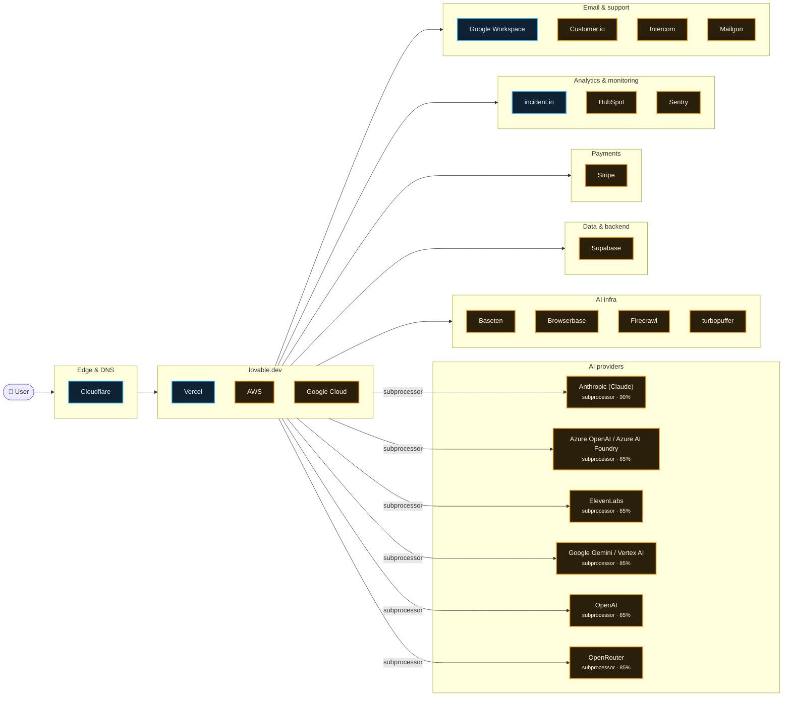

# What lovable.dev runs on

Scanned https://lovable.dev/ at 2026-10-15T04:52:57.239Z · 71 signals · 0.0 MB of JavaScript inspected

## AI providers

| Provider | Strongest evidence | Confidence | Models seen |
| --- | --- | --- | --- |
| Anthropic (Claude) | named on subprocessor, trust or status page | 90% | — |
| Azure OpenAI / Azure AI Foundry | named on subprocessor, trust or status page | 85% | — |
| ElevenLabs | named on subprocessor, trust or status page | 85% | — |
| Google Gemini / Vertex AI | named on subprocessor, trust or status page | 85% | — |
| OpenAI | named on subprocessor, trust or status page | 85% | — |
| OpenRouter | named on subprocessor, trust or status page | 85% | — |

## Edge & DNS

- **Cloudflare** — infra, 99%

## App

- **Vercel** — infra, 90%
- **AWS** — subprocessor, 85%
- **Google Cloud** — subprocessor, 85%

## AI infra

- **Baseten** — subprocessor, 85%
- **Browserbase** — subprocessor, 85%
- **Firecrawl** — subprocessor, 85%
- **turbopuffer** — subprocessor, 85%

## Data & backend

- **Supabase** — subprocessor, 92%

## Payments

- **Stripe** — subprocessor, 95%

## Analytics & monitoring

- **incident.io** — infra, 90%
- **HubSpot** — subprocessor, 85%
- **Sentry** — subprocessor, 85%

## Email & support

- **Google Workspace** — infra, 90%
- **Customer.io** — subprocessor, 85%
- **Intercom** — subprocessor, 85%
- **Mailgun** — subprocessor, 85%

## Team tools (from DNS verification records)

Amp (Sourcegraph) · Apple Business · Cursor · HackerOne · Notion · Postman · Slack

## Evidence

<b>Cloudflare</b> · edge · 99%

- `infra` dns-ns @ lovable.dev: `rafe.ns.cloudflare.com`
- `infra` dns-ns @ lovable.dev: `ivan.ns.cloudflare.com`
- `infra` header @ https://lovable.dev/: `server: cloudflare`
- `infra` header @ https://lovable.dev/: `cf-ray: a4ac37a3acff8e14-MAA`
- `infra` cookie @ https://lovable.dev/: `__cf_bm`
- `declared` subprocessors @ https://trust.lovable.dev/subprocessors: `…y default) https://supabase.com/ Opens in new tab Cloudflare • Edge routing, DNS & Workers Global cloudflare.c…`

<b>Stripe</b> · payments · 95%

- `declared` subprocessors @ https://trust.lovable.dev/subprocessors: `…stack for customer apps N/A https://tanstack.com/ Stripe https://stripe.com/ Payment processing US HubSpot…`
- `mention` legal @ https://lovable.dev/privacy: `…le information, payment information (processed by Stripe; we do not store full card numbers — see stripe.c…`
- `account` dns-txt @ lovable.dev: `stripe-verification=7745a132eb718320ef9b019600b38447c1f01e64f5dd1f552677f417c6d6f26f`
- `account` dns-txt @ lovable.dev: `stripe-verification=B07012203972AF35C48B6824427B5340CEA057BF2A11E1382CD18C11EF6ACF34`

<b>Supabase</b> · backend · 92%

- `declared` subprocessors @ https://trust.lovable.dev/subprocessors: `…Central US https://ai.azure.com Opens in new tab Supabase • Customer databases, user authentication data EU…`
- `mention` legal @ https://lovable.dev/privacy: `…ct a third-party integration (for example GitHub, Supabase, or an MCP connector), we receive the data that i…`

<b>Anthropic (Claude)</b> · ai-provider · 90%

> An anthropic-domain-verification TXT record proves a Claude/Anthropic Console account, not that the product calls the API.

- `declared` subprocessors @ https://trust.lovable.dev/subprocessors: `…com/ Custom domain connection and DNS records. US Anthropic (Claude) https://www.anthropic.com/ Customer prom…`
- `account` dns-txt @ lovable.dev: `anthropic-domain-verification-95vfce=IAyfkWTEKjd9t53RhPHjmGYsS`
- `account` dns-txt @ lovable.dev: `anthropic-domain-verification-c2572d=xa8RKIfn893ZWQCIYxj9rwArr`

<b>Google Workspace</b> · email · 90%

- `infra` dns-mx @ lovable.dev: `aspmx.l.google.com`
- `infra` dns-mx @ lovable.dev: `alt1.aspmx.l.google.com`
- `infra` dns-mx @ lovable.dev: `alt2.aspmx.l.google.com`
- `infra` dns-mx @ lovable.dev: `aspmx2.googlemail.com`
- `infra` dns-mx @ lovable.dev: `aspmx3.googlemail.com`

<b>incident.io</b> · monitoring · 90%

- `infra` dns-cname @ status.lovable.dev: `statuspage.incident.io`

<b>Vanta</b> · compliance · 90%

- `infra` dns-cname @ trust.lovable.dev: `67d1ae1cb4773dbf3d764093.cname.vantatrust.com`

<b>Vercel</b> · hosting · 90%

- `infra` dns-cname @ docs.lovable.dev: `cname.vercel-dns.com`

<b>AWS</b> · hosting · 85%

- `declared` subprocessors @ https://trust.lovable.dev/subprocessors: `…-west4) https://cloud.google.com Opens in new tab Amazon Web Services • Customer applications, databases, file storage…`
- `declared` subprocessors @ https://trust.lovable.dev/subprocessors: `…ayloads are retained in event history UK (London, AWS eu-west-2) https://temporal.io Opens in new tab M…`

<b>Azure OpenAI / Azure AI Foundry</b> · ai-provider · 85%

- `declared` subprocessors @ https://trust.lovable.dev/subprocessors: `…tps://aws.amazon.com/ Opens in new tab Microsoft (Azure AI Foundry) • AI model inference for the AI Gateway EU: West…`

<b>Baseten</b> · ai-infra · 85%

- `declared` subprocessors @ https://trust.lovable.dev/subprocessors: `…erence for the Lovable agent. Global fireworks.ai Baseten https://www.baseten.co/ AI model inference for th…`

<b>Browserbase</b> · ai-infra · 85%

- `declared` subprocessors @ https://trust.lovable.dev/subprocessors: `…customer data to power search EU Turbopuffer.com Browserbase https://www.browserbase.com/ Customer projects US…`

<b>Customer.io</b> · email · 85%

- `declared` subprocessors @ https://trust.lovable.dev/subprocessors: `…ubspot.com Marketing & CRM US https://hubspot.com Customer.io https://customer.io/ Customer engagement US https…`

<b>ElevenLabs</b> · ai-provider · 85%

- `declared` subprocessors @ https://trust.lovable.dev/subprocessors: `…nference for the Lovable agent. Global baseten.co ElevenLabs https://elevenlabs.io Speech-to-text, text-to-spe…`

<b>Firecrawl</b> · ai-infra · 85%

- `declared` subprocessors @ https://trust.lovable.dev/subprocessors: `…for customer apps and the agent. US perplexity.ai Firecrawl https://www.firecrawl.dev/ Web crawling on custom…`

<b>Google Cloud</b> · hosting · 85%

- `declared` subprocessors @ https://trust.lovable.dev/subprocessors: `…pdates Ask a question Subprocessors Subprocessors Google Cloud Platform • Customer applications, databases and platform i…`
- `declared` subprocessors @ https://trust.lovable.dev/: `…rational Security controls Subprocessors View all Google Cloud Platform • Customer applications, databases and platform i…`

<b>Google Gemini / Vertex AI</b> · ai-provider · 85%

- `declared` subprocessors @ https://trust.lovable.dev/subprocessors: `…://cloud.google.com/vertex-ai AI model inference (Gemini models) for customer prompts and responses. US https://c…`
- `declared` subprocessors @ https://trust.lovable.dev/subprocessors: `…Kubernetes Engine, Cloud Run, Spanner, Cloud KMS, Vertex AI EU (Netherlands, europe-west4) https://cloud.goog…`

<b>HubSpot</b> · analytics · 85%

- `declared` subprocessors @ https://trust.lovable.dev/subprocessors: `…Stripe https://stripe.com/ Payment processing US HubSpot https://www.hubspot.com Marketing & CRM US https:…`

<b>Intercom</b> · support · 85%

- `declared` subprocessors @ https://trust.lovable.dev/subprocessors: `…nal email, email domain management US mailgun.com Intercom https://www.intercom.com/ Customer support commun…`

<b>Mailgun</b> · email · 85%

- `declared` subprocessors @ https://trust.lovable.dev/subprocessors: `…r.io/ Customer engagement US https://customer.io/ Mailgun https://www.mailgun.com/ Transactional email, ema…`

<b>OpenAI</b> · ai-provider · 85%

> An openai-domain-verification TXT record proves an OpenAI account (often ChatGPT Enterprise), not that the product calls the API.

- `declared` subprocessors @ https://trust.lovable.dev/subprocessors: `…responses. US https://cloud.google.com/vertex-ai OpenAI https://openai.com/ Customer prompts, generated c…`

<b>OpenRouter</b> · ai-provider · 85%

- `declared` subprocessors @ https://trust.lovable.dev/subprocessors: `…ated code, AI interactions US https://openai.com/ OpenRouter https://openrouter.ai/ LLM inference routing US F…`

<b>Sentry</b> · monitoring · 85%

- `declared` subprocessors @ https://trust.lovable.dev/subprocessors: `…https://grafana.com Log/trace/metrics storage US Sentry https://sentry.io/ Performance monitoring US http…`

<b>turbopuffer</b> · ai-infra · 85%

- `declared` subprocessors @ https://trust.lovable.dev/subprocessors: `…epository US https://github.com/ Opens in new tab Turbopuffer • Indexing customer data to power search EU https…`

<b>Okta</b> · auth · 45%

- `mention` legal @ https://lovable.dev/security: `…integrates with SAML and OIDC providers including Okta, Azure AD, and Google. SCIM supports automated pr…`

<b>Amp (Sourcegraph)</b> · team-tools · 35%

- `account` dns-txt @ lovable.dev: `amp-domain-verification-dfy9k3=lPhxodbdvlv0OU92ZSep0nGFJ`

<b>Apple Business</b> · team-tools · 35%

- `account` dns-txt @ lovable.dev: `apple-domain-verification=jxKj0gdPtRTEq0fU`

<b>Cursor</b> · team-tools · 35%

- `account` dns-txt @ lovable.dev: `cursor-domain-verification-9m3nsg=8VerTaFVfyU53jD2cHwapzSgF`

<b>HackerOne</b> · team-tools · 35%

- `account` dns-txt @ lovable.dev: `h1-domain-verification=ma4NHXb8cz4E7cRH8tnTRtipBvjAR3hYqGAUHqtnMzwiipf8`

<b>Microsoft 365</b> · email · 35%

- `account` dns-txt @ lovable.dev: `MS=ms32653213`
- `account` dns-txt @ lovable.dev: `MS=ms86659436`

<b>Notion</b> · team-tools · 35%

- `account` dns-txt @ lovable.dev: `notion-domain-verification=mcD3dNYGsdLZsl4EJR2BgTC3WVBhdPw2RDedNmUrEhK`

<b>Postman</b> · team-tools · 35%

- `account` dns-txt @ lovable.dev: `postman-domain-verification=ffb79bb9c80faf1bb8223db45cd798587f260f74e167153f6f06b185be6c4542aec24eebb04945d0bbb4b8c52fa74b9c99e60b381680348a…`

<b>Slack</b> · team-tools · 35%

- `account` dns-txt @ lovable.dev: `slack-domain-verification=btcoSYSdlb1jOQA15YSkQOTr6VMOT6OiVrIJ1bQ8`

## Limitations

- This is an outside-in scan. Calls a backend makes to an LLM API never touch the browser, so they only show up if the company declares them (subprocessor list, trust center, status page) or ships references in client code.
- `DNS account` evidence means the company verified its domain with that vendor. That often means employees use it (e.g. ChatGPT Enterprise, Claude for Work), not that the product calls it.
- `in bundle` means shipped JavaScript references the vendor or model id. Model pickers and marketing pages can mention models that are routed through another provider.
- Run with `--rea` to add live network observation through REA (github.com/morluto/rea).

Collector errors

- web: https://lovable.dev/: HTTP 403 (bot protection); try --rea or --url with another page

