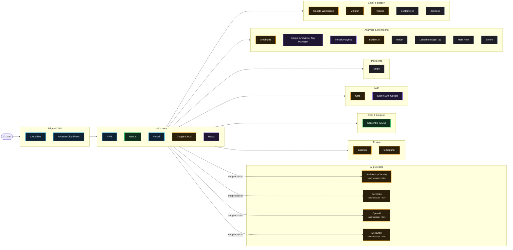

# What notion.com runs on

Scanned https://www.notion.com/ at 2026-10-15T04:53:59.187Z · 631 signals · 1.8 MB of JavaScript inspected

## AI providers

| Provider | Strongest evidence | Confidence | Models seen |
| --- | --- | --- | --- |
| Anthropic (Claude) | named on subprocessor, trust or status page | 85% | — |
| Cerebras | named on subprocessor, trust or status page | 85% | — |
| OpenAI | named on subprocessor, trust or status page | 85% | — |
| xAI (Grok) | named on subprocessor, trust or status page | 85% | — |

## Edge & DNS

- **Cloudflare** — infra, 99%
- **Amazon CloudFront** — infra, 90%

## App

- **AWS** — infra, 99%
- **Next.js** — live, 99%
- **Vercel** — infra, 99%
- **Google Cloud** — subprocessor, 85%
- **React** — in bundle, 70%

## AI infra

- **Baseten** — subprocessor, 85%
- **turbopuffer** — subprocessor, 85%

## Data & backend

- **Contentful (CMS)** — live, 99%

## Auth

- **Okta** — subprocessor, 85%
- **Sign in with Google** — in bundle, 70%

## Payments

- **Stripe** — CSP, 60%

## Analytics & monitoring

- **Amplitude** — subprocessor, 94%
- **Google Analytics / Tag Manager** — in bundle, 88%
- **Vercel Analytics** — in bundle, 88%
- **incident.io** — subprocessor, 85%
- **Hotjar** — CSP, 60%
- **LinkedIn Insight Tag** — CSP, 60%
- **Meta Pixel** — CSP, 60%
- **Sentry** — CSP, 60%

## Email & support

- **Google Workspace** — subprocessor, 85%
- **Mailgun** — subprocessor, 85%
- **Resend** — subprocessor, 85%
- **Customer.io** — CSP, 60%
- **Zendesk** — CSP, 60%

## Team tools (from DNS verification records)

Postman · Zoom

## Evidence

<b>AWS</b> · hosting · 99%

- `infra` header @ https://app.notion.com/: `x-amz-id-2: kVHUXx5NHyqzhGlzuJWC5+sONnwoW02HlVA4Sn68fbgn5wClnW1nnlidizO8taAAxGAP6m3iXTo=`
- `infra` header @ https://app.notion.com/: `x-amz-request-id: Y0JESB21K8SPM4PB`
- `declared` subprocessors @ https://trust.notion.com/subprocessors: `…est access Subprocessors See all 26 subprocessors AWS · USA, European Union, Korea, Japan Hosting and s…`

<b>Cloudflare</b> · edge · 99%

- `infra` dns-ns @ notion.com: `woz.ns.cloudflare.com`
- `infra` dns-ns @ notion.com: `dana.ns.cloudflare.com`
- `infra` header @ https://www.notion.com/: `server: cloudflare`
- `infra` header @ https://www.notion.com/: `cf-ray: a4ac39272a0c7f8e-MAA`
- `infra` header @ https://app.notion.com/: `cf-ray: a4ac39280a147f73-MAA`
- `infra` cookie @ https://www.notion.com/: `__cf_bm`
- `infra` cookie @ https://app.notion.com/: `_cfuvid`
- `declared` subprocessors @ https://trust.notion.com/subprocessors: `…ubprocessors in this trust center, including AWS, Cloudflare, and Google Cloud. See the subprocessors section…`

<b>Contentful (CMS)</b> · backend · 99%

- `observed` resource @ https://images.ctfassets.net/: `images.ctfassets.net`
- `bundle` bundle @ javascript bundles: `…:false,"liveAssets":{"heroPoster":{"src":"https://images.ctfassets.net/spoqsaf9291f/3kVtQWll6jUqQepQ0kaYlz/382b34f23ecb3…`
- `config` csp @ https://www.notion.com/: `images.ctfassets.net`

<b>Next.js</b> · framework · 99%

- `observed` html @ https://www.notion.com/: `…rossorigin="anonymous"/><link rel="preload" href="/_next/static/chunks/3nr739qv1y-ex.css" as="style"/><link rel="p…`
- `observed` html @ https://www.notion.com/: `…/div>
</footer>

<script id="__NEXT_DATA__" type="application/json">{"props":{"pageProps":{"…`
- `infra` header @ https://www.notion.com/: `x-powered-by: Next.js`
- `infra` header @ https://www.notion.com/: `x-matched-path: /en-us/product`

<b>Vercel</b> · hosting · 99%

- `infra` header @ https://www.notion.com/: `x-vercel-id: bom1::pdx1::zfgd2-1792040039591-41ac65c08214`
- `infra` header @ https://www.notion.com/: `x-vercel-cache: HIT`
- `declared` subprocessors @ https://trust.notion.com/subprocessors: `…s Regulations Trusted by OpenAI Figma Ramp Cursor Vercel NVIDIA Volvo L'Oréal Discord Lovable 1Password To…`

<b>Amplitude</b> · analytics · 94%

- `declared` subprocessors @ https://trust.notion.com/subprocessors: `…cluding analytics, messaging, and data pipelines. Amplitude · USA Event logging for analytics. USA Customer ·…`
- `config` csp @ https://www.notion.com/: `cdn.amplitude.com`
- `config` csp @ https://www.notion.com/: `api.amplitude.com`

<b>Amazon CloudFront</b> · edge · 90%

- `infra` dns-cname @ trust.notion.com: `dg7yax2nb93oh.cloudfront.net`

<b>Google Analytics / Tag Manager</b> · analytics · 88%

- `bundle` bundle @ javascript bundles: `…r-script-init",strategy:"lazyOnload",src:"https://www.googletagmanager.com/gtm.js?id=GTM-MTWKTL4"}),(0,t.jsx)("noscript",{ch…`
- `config` csp @ https://www.notion.com/: `www.googletagmanager.com`
- `config` csp @ https://www.notion.com/: `www.google-analytics.com`
- `config` csp @ https://www.notion.com/: `region1.google-analytics.com`

<b>Vercel Analytics</b> · analytics · 88%

- `bundle` bundle @ javascript bundles: `…,{src:(r=o).scriptSrc?O(r.scriptSrc):x()?"https://va.vercel-scripts.com/v1/speed-insights/script.debug.js":r.dsn?"https:/…`
- `config` csp @ https://www.notion.com/: `va.vercel-scripts.com`

<b>Anthropic (Claude)</b> · ai-provider · 85%

> An anthropic-domain-verification TXT record proves a Claude/Anthropic Console account, not that the product calls the API.

- `declared` subprocessors @ https://trust.notion.com/subprocessors: `…stems provider. USA, European Union, Korea, Japan Anthropic · Global Service provider for AI agents, hosting…`

<b>Baseten</b> · ai-infra · 85%

- `declared` subprocessors @ https://trust.notion.com/subprocessors: `…Runlayer · USA Security for MCP connections. USA Baseten Labs, Inc. · Global Service provider for hosting…`

<b>Cerebras</b> · ai-provider · 85%

- `declared` subprocessors @ https://trust.notion.com/subprocessors: `…ting large language models and embeddings. Global Cerebras Systems Inc. · USA Service provider for hosting l…`

<b>Google Cloud</b> · hosting · 85%

- `declared` subprocessors @ https://trust.notion.com/subprocessors: `…this trust center, including AWS, Cloudflare, and Google Cloud. See the subprocessors section for details. How d…`

<b>Google Workspace</b> · email · 85%

- `declared` subprocessors @ https://trust.notion.com/subprocessors: `…ity providers including Okta, Microsoft Entra ID, Google Workspace, and OneLogin. Workspace administrators can enfor…`

<b>incident.io</b> · monitoring · 85%

- `declared` status @ https://www.notion-status.com/: `…\n14:E{\"digest\":\"NEXT_REDIRECT;replace;https://incident.io/status-pages?utm_source=status-page;307;\"}\na:[[…`

<b>Mailgun</b> · email · 85%

- `declared` subprocessors @ https://trust.notion.com/subprocessors: `…to our data warehouse. USA, Germany, Korea, Japan Mailgun · USA Transactional, broadcast, and marketing mes…`

<b>Okta</b> · auth · 85%

- `declared` subprocessors @ https://trust.notion.com/subprocessors: `…based SSO with major identity providers including Okta, Microsoft Entra ID, Google Workspace, and OneLog…`

<b>OpenAI</b> · ai-provider · 85%

> An openai-domain-verification TXT record proves an OpenAI account (often ChatGPT Enterprise), not that the product calls the API.

- `declared` subprocessors @ https://trust.notion.com/subprocessors: `…g. Read more Audit Reports Regulations Trusted by OpenAI Figma Ramp Cursor Vercel NVIDIA Volvo L'Oréal Dis…`

<b>Resend</b> · email · 85%

- `declared` subprocessors @ https://trust.notion.com/subprocessors: `…here's no need to submit it again.","resendLink":"Resend link","useDifferentEmail":"Use a different email"…`
- `declared` status @ https://www.notion-status.com/: `…\",\"verify_button\":\"Verify\",\"resend_code\":\"Resend code\",\"resend_code_sent\":\"Code sent!\",\"inva…`

<b>turbopuffer</b> · ai-infra · 85%

- `declared` subprocessors @ https://trust.notion.com/subprocessors: `…in-product analytics. USA, Germany, Korea, Japan Turbopuffer · USA, Germany, Korea, Japan Vector database for…`

<b>xAI (Grok)</b> · ai-provider · 85%

- `declared` subprocessors @ https://trust.notion.com/subprocessors: `…t enable code execution and AI agent actions. USA X.AI LLC · USA, UK Service provider for hosting large lang…`

<b>React</b> · framework · 70%

- `bundle` bundle @ javascript bundles: `…n}}var eO=Math.random().toString(36).slice(2),ez="__reactFiber$"+eO,eM="__reactProps$"+eO,eD="__reactContainer$"+…`
- `bundle` bundle @ javascript bundles: `…),ez="__reactFiber$"+eO,eM="__reactProps$"+eO,eD="__reactContainer$"+eO,eI="__reactEvents$"+eO,eF="__reactListeners$"…`
- `bundle` bundle @ javascript bundles: `…},216982,(e,t,r)=>{"use strict";var n=Symbol.for("react.transitional.element");function o(e,t,r){var o=null;if(void 0!==r&&(o=…`
- `bundle` bundle @ javascript bundles: `…";var n="function"==typeof Symbol&&Symbol.for,i=n?Symbol.for("react.element"):60103,o=n?Symbol.for("react.portal"):60106,s=n?Sy…`

<b>Sign in with Google</b> · auth · 70%

- `bundle` bundle @ javascript bundles: `…ment,{children:[(0,t.jsx)(l.default,{src:"https://accounts.google.com/gsi/client",strategy:"lazyOnload",onLoad:()=>{s()}}),…`

<b>Customer.io</b> · email · 60%

- `config` csp @ https://www.notion.com/: `assets.customer.io`
- `config` csp @ https://www.notion.com/: `track.customer.io`

<b>Hotjar</b> · analytics · 60%

- `config` csp @ https://www.notion.com/: `static.hotjar.com`
- `config` csp @ https://www.notion.com/: `script.hotjar.com`

<b>LinkedIn Insight Tag</b> · analytics · 60%

- `config` csp @ https://www.notion.com/: `snap.licdn.com`
- `config` csp @ https://www.notion.com/: `px.ads.linkedin.com`

<b>Meta Pixel</b> · analytics · 60%

- `config` csp @ https://www.notion.com/: `connect.facebook.net`

<b>Sentry</b> · monitoring · 60%

- `config` csp @ https://www.notion.com/: `js.sentry-cdn.com`

<b>Statsig</b> · analytics · 60%

- `config` csp @ https://www.notion.com/: `api.statsig.com`

<b>Stripe</b> · payments · 60%

- `config` csp @ https://www.notion.com/: `js.stripe.com`
- `config` csp @ https://www.notion.com/: `checkout.stripe.com`

<b>X (Twitter) Pixel</b> · analytics · 60%

- `config` csp @ https://www.notion.com/: `static.ads-twitter.com`

<b>Zendesk</b> · support · 60%

- `config` csp @ https://www.notion.com/: `static.zdassets.com`
- `config` csp @ https://www.notion.com/: `ekr.zendesk.com`
- `config` csp @ https://www.notion.com/: `makenotion.zendesk.com`

<b>Microsoft 365</b> · email · 35%

- `account` dns-txt @ notion.com: `MS=ms30471993`

<b>Postman</b> · team-tools · 35%

- `account` dns-txt @ notion.com: `postman-domain-verification=a713ed7f186c1901e299d55957b0e1bdfaf8f7d5aff31fbc6d49765defe5e190ab5c217a736b4ad45c553409b5b9d519977eb68ba3db7338…`

<b>Zoom</b> · team-tools · 35%

- `account` dns-txt @ notion.com: `zoom-domain-verification=ZOOM_verify_7d721e1c5c134ba6aa478d5d4315ca01`

## Limitations

- This is an outside-in scan. Calls a backend makes to an LLM API never touch the browser, so they only show up if the company declares them (subprocessor list, trust center, status page) or ships references in client code.
- `DNS account` evidence means the company verified its domain with that vendor. That often means employees use it (e.g. ChatGPT Enterprise, Claude for Work), not that the product calls it.
- `in bundle` means shipped JavaScript references the vendor or model id. Model pickers and marketing pages can mention models that are routed through another provider.
- Run with `--rea` to add live network observation through REA (github.com/morluto/rea).
