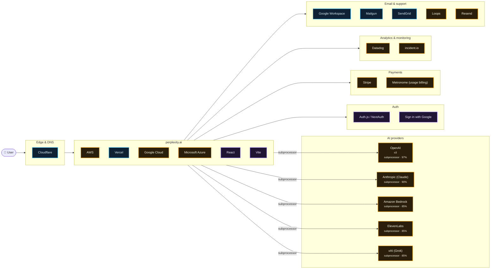

# What perplexity.ai runs on

Scanned https://www.perplexity.ai/ at 2026-10-15T04:52:40.813Z · 161 signals · 4.0 MB of JavaScript inspected

## AI providers

| Provider | Strongest evidence | Confidence | Models seen |
| --- | --- | --- | --- |
| OpenAI | named on subprocessor, trust or status page | 97% | o3 |
| Anthropic (Claude) | named on subprocessor, trust or status page | 90% | — |
| Amazon Bedrock | named on subprocessor, trust or status page | 85% | — |
| ElevenLabs | named on subprocessor, trust or status page | 85% | — |
| xAI (Grok) | named on subprocessor, trust or status page | 85% | — |

## Edge & DNS

- **Cloudflare** — infra, 99%

## App

- **AWS** — subprocessor, 92%
- **Vercel** — infra, 90%
- **Google Cloud** — subprocessor, 85%
- **Microsoft Azure** — subprocessor, 85%
- **React** — in bundle, 70%
- **Vite** — in bundle, 70%

## Auth

- **Auth.js / NextAuth** — in bundle, 70%
- **Sign in with Google** — in bundle, 70%

## Payments

- **Stripe** — subprocessor, 90%
- **Metronome (usage billing)** — subprocessor, 85%

## Analytics & monitoring

- **Datadog** — subprocessor, 96%
- **incident.io** — subprocessor, 85%

## Email & support

- **Google Workspace** — infra, 90%
- **Mailgun** — infra, 90%
- **SendGrid** — infra, 90%
- **Loops** — subprocessor, 85%
- **Resend** — subprocessor, 85%

## Team tools (from DNS verification records)

Apple Business · Cursor · Notion · Rippling · Slack · Zapier · Zoom

## Evidence

<b>Cloudflare</b> · edge · 99%

- `infra` dns-ns @ perplexity.ai: `jessica.ns.cloudflare.com`
- `infra` dns-ns @ perplexity.ai: `emerson.ns.cloudflare.com`
- `infra` header @ https://www.perplexity.ai/: `server: cloudflare`
- `infra` header @ https://www.perplexity.ai/: `cf-ray: a4ac373d4e11faad-MAA`
- `infra` cookie @ https://www.perplexity.ai/: `__cf_bm`
- `declared` subprocessors @ https://trust.perplexity.ai/subprocessors: `…h and deployment, including AI models like Claude Cloudflare • Cloud monitoring US Edge network and security i…`
- `mention` legal @ https://www.perplexity.ai/hub/security: `…ss controls. For additional security, we leverage Cloudflare&#x27;s robust services. Their global network prov…`

<b>Vanta</b> · compliance · 99%

- `infra` dns-cname @ trust.perplexity.ai: `67f944b791e9d10e65012aba.cname.vantatrust.com`
- `declared` subprocessors @ https://trust.perplexity.ai/: `…uarterly ongoing authorization report for 2026 Q2 Vanta connects to a company's core systems to continuou…`

<b>OpenAI</b> · ai-provider · 97%

> An openai-domain-verification TXT record proves an OpenAI account (often ChatGPT Enterprise), not that the product calls the API.

- `declared` subprocessors @ https://trust.perplexity.ai/subprocessors: `…S https://servicetrust.microsoft.com/viewpage/SOC OpenAI OpenAI is an artificial intelligence (AI) researc…`
- `bundle` bundle @ javascript bundles: `o3`
- `account` dns-txt @ perplexity.ai: `openai-domain-verification=dv-zghu2IboDSNgZtbkqFK3Rxb0`

<b>Datadog</b> · monitoring · 96%

- `declared` subprocessors @ https://trust.perplexity.ai/subprocessors: `…ge and processing US https://trust.snowflake.com/ Datadog Cloud monitoring and observability platform Cloud…`
- `bundle` bundle @ javascript bundles: `…ATION:'configuration',USAGE:'usage'},Fr=['https://www.datadoghq-browser-agent.com','https://www.datad0g-browser-agent.com','https:/…`
- `bundle` bundle @ javascript bundles: `…_action?.id}}:Mr});function n(e){let n=r(e,Mo()?t.DD_RUM_SYNTHETICS:t.DD_RUM);if(n)return n}function r(e,t…`
- `bundle` bundle @ javascript bundles: `…N:'configuration',USAGE:'usage'},Fr=['https://www.datadoghq-browser-agent.com','https://www.datad0g-browser-agent.com','htt…`

<b>AWS</b> · hosting · 92%

- `declared` subprocessors @ https://trust.perplexity.ai/subprocessors: `…S Artificial intelligence research and deployment Amazon Web Services • Cloud provider US Cloud infrastructure and secu…`
- `mention` legal @ https://www.perplexity.ai/hub/security: `…To further enhance security, Perplexity utilizes AWS IAM for managing access to our production environ…`

<b>Anthropic (Claude)</b> · ai-provider · 90%

> An anthropic-domain-verification TXT record proves a Claude/Anthropic Console account, not that the product calls the API.

- `declared` subprocessors @ https://trust.perplexity.ai/subprocessors: `…oud provider US Cloud infrastructure and security Anthropic • Cloud provider US Artificial intelligence resea…`
- `account` dns-txt @ perplexity.ai: `anthropic-domain-verification-0nxh7b=KC5XJ4tf0NfPwfWCzA2o4xBkf`

<b>Google Workspace</b> · email · 90%

- `infra` dns-txt @ perplexity.ai: `v=spf1 ip4:192.174.84.143 include:_spf.google.com include:mailgun.org include:sendgrid.net ~all`
- `infra` dns-mx @ perplexity.ai: `alt2.aspmx.l.google.com`
- `infra` dns-mx @ perplexity.ai: `aspmx.l.google.com`
- `infra` dns-mx @ perplexity.ai: `alt3.aspmx.l.google.com`
- `infra` dns-mx @ perplexity.ai: `alt4.aspmx.l.google.com`
- `infra` dns-mx @ perplexity.ai: `alt1.aspmx.l.google.com`

<b>Mailgun</b> · email · 90%

- `infra` dns-txt @ perplexity.ai: `v=spf1 ip4:192.174.84.143 include:_spf.google.com include:mailgun.org include:sendgrid.net ~all`

<b>SendGrid</b> · email · 90%

- `infra` dns-txt @ perplexity.ai: `v=spf1 ip4:192.174.84.143 include:_spf.google.com include:mailgun.org include:sendgrid.net ~all`

<b>Stripe</b> · payments · 90%

- `declared` subprocessors @ https://trust.perplexity.ai/subprocessors: `…ic Data Integration and Movement US polytomic.com Stripe Payment processing platform Finance and payments…`
- `account` dns-txt @ perplexity.ai: `stripe-verification=821710750b8dc95b687842d6603d34e3a11d38b8eb098663fd20109562fa64ed`
- `account` dns-txt @ perplexity.ai: `stripe-verification=914D051C480FE385B2DA0F1AAA80251B398A11417CA17E79FA1F8A3633AB4E47`

<b>Vercel</b> · hosting · 90%

- `infra` dns-cname @ docs.perplexity.ai: `cname.vercel-dns.com`

<b>Amazon Bedrock</b> · ai-provider · 85%

- `declared` subprocessors @ https://trust.perplexity.ai/subprocessors: `…gestion platform US Data integration and movement Amazon Bedrock • Cloud provider US Artificial intelligence resea…`

<b>ElevenLabs</b> · ai-provider · 85%

- `declared` subprocessors @ https://trust.perplexity.ai/subprocessors: `…• Data analytics US Data quality monitoring tool ElevenLabs • Text-to-speech services US Text-to-speech servi…`

<b>Google Cloud</b> · hosting · 85%

- `declared` subprocessors @ https://trust.perplexity.ai/subprocessors: `…gestion Platform US Data integration and movement Google Cloud • Cloud provider US Artificial intelligence resea…`

<b>incident.io</b> · monitoring · 85%

- `declared` status @ https://status.perplexity.com/: `…\n14:E{\"digest\":\"NEXT_REDIRECT;replace;https://incident.io/status-pages?utm_source=status-page;307;\"}\na:[[…`

<b>Loops</b> · email · 85%

- `declared` subprocessors @ https://trust.perplexity.ai/subprocessors: `…ce tool Data analytics US https://trust.hex.tech/ Loops.so Email marketing and automation platform Marketing…`

<b>Metronome (usage billing)</b> · payments · 85%

- `declared` subprocessors @ https://trust.perplexity.ai/subprocessors: `…I platform Integrations US https://www.merge.dev/ Metronome Payment processing platform Finance and payments…`

<b>Microsoft Azure</b> · hosting · 85%

- `declared` subprocessors @ https://trust.perplexity.ai/subprocessors: `…ng platform Finance and payments US metronome.com Microsoft Azure Cloud computing services including Infrastructure…`

<b>Resend</b> · email · 85%

- `declared` status @ https://status.perplexity.com/: `…\",\"verify_button\":\"Verify\",\"resend_code\":\"Resend code\",\"resend_code_sent\":\"Code sent!\",\"inva…`

<b>xAI (Grok)</b> · ai-provider · 85%

- `declared` subprocessors @ https://trust.perplexity.ai/subprocessors: `…atform Finance and payments US https://stripe.com xAI Artificial intelligence research and deployment,…`

<b>Auth.js / NextAuth</b> · auth · 70%

- `bundle` bundle @ javascript bundles: `…{try{let{data:e,error:t,response:n}=await Tc.GET('/api/auth/session','getSession',{numRetries:Pl,backOffTime:500});if…`

<b>React</b> · framework · 70%

- `bundle` bundle @ javascript bundles: `…n}}var dt=Math.random().toString(36).slice(2),ft='__reactFiber$'+dt,pt='__reactProps$'+dt,mt='__reactContainer$'+…`
- `bundle` bundle @ javascript bundles: `…),ft='__reactFiber$'+dt,pt='__reactProps$'+dt,mt='__reactContainer$'+dt,j='__reactEvents$'+dt,ht='__reactListeners$'+…`
- `bundle` bundle @ javascript bundles: `…e__v2-CYtfOYgs.js";var a=r((e=>{var t=Symbol.for('react.transitional.element'),n=Symbol.for('react.fragment');function r(e,n,r…`

<b>Sign in with Google</b> · auth · 70%

- `bundle` bundle @ javascript bundles: `…n=document.createElement('script');n.src='https://accounts.google.com/gsi/client',n.id=wl,n.onload=()=>e(),n.onerror=t,docu…`

<b>Vite</b> · framework · 70%

- `bundle` bundle @ javascript bundles: `…pa/assets/openfeature__v2-CSYNA2bw.js.map ; const __vite__mapDeps=(i,m=__vite__mapDeps,d=(m.f||(m.f=["https://pplx-…`

<b>Apple Business</b> · team-tools · 35%

- `account` dns-txt @ perplexity.ai: `apple-domain-verification=ZMuRv99LHvsS1KTp`

<b>Cursor</b> · team-tools · 35%

- `account` dns-txt @ perplexity.ai: `cursor-domain-verification-5wqrf2=1wEeLXdDy8nL5srlwT1wz3LxO`

<b>HubSpot</b> · analytics · 35%

- `account` dns-txt @ perplexity.ai: `hubspot-developer-verification=YjMzZTc5ZDktNmMyYi00YTQ4LWIyYjEtM2IxMGZlMTVmZWIx`

<b>Microsoft 365</b> · email · 35%

- `account` dns-txt @ perplexity.ai: `MS=ms75545187`

<b>Notion</b> · team-tools · 35%

- `account` dns-txt @ perplexity.ai: `notion-domain-verification=5Dz8REUMU45X6GGssEa56YmEwFOVaZV7cNgWCWke1Io`

<b>Proton Mail</b> · email · 35%

- `account` dns-txt @ perplexity.ai: `protonmail-verification=6ac7d35c79dab9552062e5584ef4a8fb1b7787ce`

<b>Rippling</b> · team-tools · 35%

- `account` dns-txt @ perplexity.ai: `rippling-domain-verification=84aebb4e59f08038`

<b>Slack</b> · team-tools · 35%

- `account` dns-txt @ perplexity.ai: `slack-domain-verification=yVf6nREGJnj6LBCkLLADFdZbC32dWQ4Nnlpnptqw`

<b>Zapier</b> · team-tools · 35%

- `account` dns-txt @ perplexity.ai: `zapier-domain-verification-challenge=bde234db-a1ee-4c32-85ad-e4c538e51067`

<b>Zoom</b> · team-tools · 35%

- `account` dns-txt @ perplexity.ai: `ZOOM_verify_TOGuaujNzVuFZdiK9EyxQ4`
- `account` dns-txt @ perplexity.ai: `zoom-domain-verification=ZOOM_verify_39653b6a9e88496eb35e41fc586d9ae2`

## Limitations

- This is an outside-in scan. Calls a backend makes to an LLM API never touch the browser, so they only show up if the company declares them (subprocessor list, trust center, status page) or ships references in client code.
- `DNS account` evidence means the company verified its domain with that vendor. That often means employees use it (e.g. ChatGPT Enterprise, Claude for Work), not that the product calls it.
- `in bundle` means shipped JavaScript references the vendor or model id. Model pickers and marketing pages can mention models that are routed through another provider.
- Run with `--rea` to add live network observation through REA (github.com/morluto/rea).
